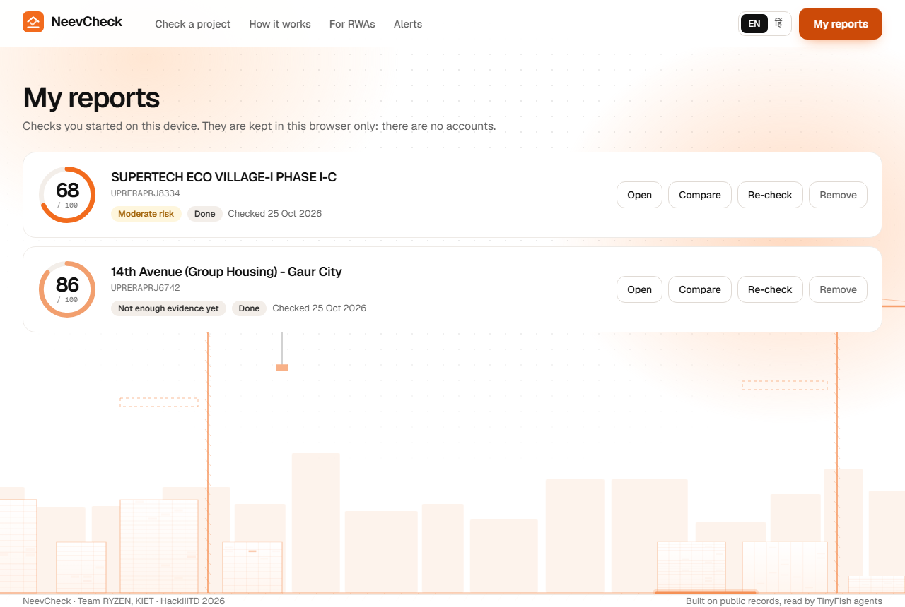
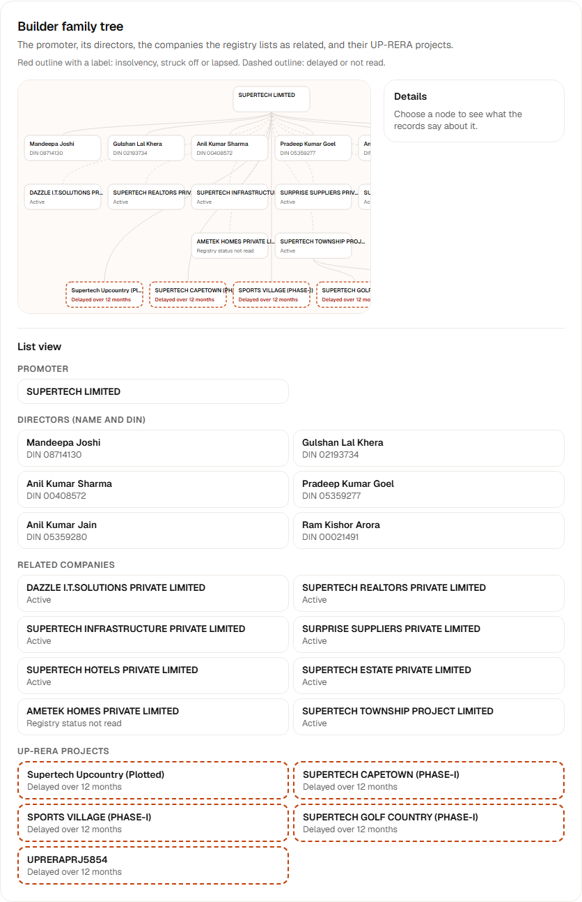
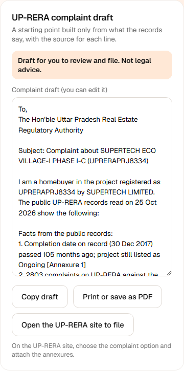
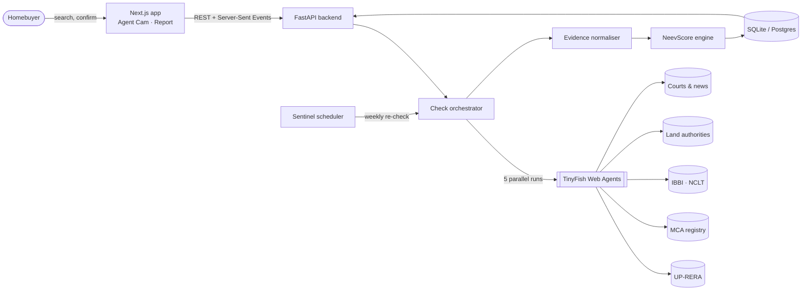

<div align="center">


# NeevCheck

### Know your builder before you book.

A risk check for under-construction homes in Uttar Pradesh. NeevCheck sends **TinyFish browser agents** to read UP-RERA, company, insolvency and court records live, then turns them into one clear **NeevScore** with proof for every point.

[](#roadmap)
[](#team)
[](https://tinyfish.ai)
[](https://nextjs.org)
[](https://fastapi.tiangolo.com)
[](https://www.python.org)
[](LICENSE)

<br>


</div>

---

## Table of contents

- [The problem](#the-problem)
- [What NeevCheck does](#what-neevcheck-does)
- [All-India coverage](#all-india-coverage)
- [See it in action](#see-it-in-action)
- [A real check: Supertech Eco Village-I Phase I-C](#a-real-check-supertech-eco-village-i-phase-i-c)
- [How it works](#how-it-works)
- [Architecture](#architecture)
- [NeevScore](#neevscore)
- [Where NeevCheck fits](#where-neevcheck-fits)
- [What a check costs](#what-a-check-costs)
- [Tech stack](#tech-stack)
- [Project structure](#project-structure)
- [Getting started](#getting-started)
- [Roadmap](#roadmap)
- [Responsible use of public data](#responsible-use-of-public-data)
- [Team](#team)

---

## The problem

Buying an under-construction flat is often a family's biggest cheque. The facts that decide whether it will be delivered are public, but they are scattered across government portals that few buyers know about, let alone read.

| | |
| --- | --- |
| **51,000** | homes Supertech booked for delivery in 2010–12, many still waiting ([Supreme Court, Feb 2026](https://www.livelaw.in/top-stories/supreme-court-upholds-nclat-order-directing-nbcc-to-complete-stalled-supertech-housing-projects-522030)) |
| **49,748** | homes in 16 stalled Supertech projects handed to NBCC to finish ([NCLAT order, Dec 2024](https://psuwatch.com/newsupdates/nbcc-appointed-as-consultant-to-complete-supertechs-16-housing-projects)) |
| **5 portals** | a buyer would need to search by hand: UP-RERA, MCA, IBBI / NCLT, land authorities, courts |

A broker's brochure says *"possession on time"*. The records may say the completion date was extended three times. NeevCheck reads the records so the buyer doesn't have to.

## What NeevCheck does

| | Feature | What the buyer gets |
| :-: | --- | --- |
| 🔎 | **Search first, no forms** | Type a project name, a promoter or a RERA number of any state (UP numbers of 2017 or the new format, a MahaRERA `P…` number and so on). We show the matching phases from the register and ask *"Is this the property you're looking for?"* before any agent runs. |
| 🤖 | **Agent Cam** | Watch TinyFish browser agents open each official site, find the project and copy the exact record, live. |
| 📊 | **NeevScore (300–900)** | One explained number, like a credit score: six weighted pillars, a confidence meter and the top reason codes (R01–R14). Every point lost links to the record behind it. The first 0–100 score is kept as one line in the method section, for transparency. |
| 🗂️ | **Evidence Locker** | Every finding carries its source link and the minute it was read. *No source, no claim.* |
| 🧬 | **Builder DNA** | Sister projects, insolvency scope and linked companies for the same promoter. |
| ✅ | **Buyer Action Plan** | Four concrete things to check before paying more. |
| ❓ | **Questions for the builder** | Five questions chosen from the findings, ready to copy into a message. |
| 🏗️ | **Builder track record** | The promoter's other UP-RERA projects, each one click from its own check. |
| 🗃️ | **My reports** | Every check you run is kept in your browser, with no account. Reopen, re-check or remove it. |
| ⚖️ | **Compare** | Two or three projects side by side, row by row; it names the best only when the evidence allows. |
| 💬 | **Share on WhatsApp** | A short message with the score and a link, for the family group. |
| 🔔 | **Neev Sentinel** | Weekly re-checks; an alert only when a record actually changes. |
| 🏟️ | **War Room** | Six lanes (the state's RERA, company registry, group companies, insolvency, land authority, news) run in parallel, each with its own live ticker and findings count. Click a lane to enlarge its live browser view. |
| 🌳 | **Builder family tree** | Promoter, directors (name and DIN only), related companies and their UP-RERA projects. Flagged nodes carry a text label, never colour alone; a list view serves phones and screen readers. |
| 📜 | **Evidence ledger** | Every claim with its page, read time, the words on the page, reliability, points and reason code. |
| ✉️ | **UP-RERA complaint draft** | One click builds an editable complaint from facts only, with numbered source annexures, in English or Hindi. *Draft for you to review and file. Not legal advice.* |
| 🛰️ | **Monitor watch** | Watching a project also creates TinyFish Monitors on its UP-RERA page and on builder news; a changed page re-scores the project and alerts with the diff. |
| 🙋 | **Right of reply** | "Report a mistake" on every report; the messages go to an operator log. |
| 🌐 | **English and हिंदी** | Plain-language reports for every family member. |

## All-India coverage

Any RERA-registered project in India can be searched. Deepest coverage is in Uttar Pradesh. How much of a record can be read depends on the state's portal, and the app says so on every result and report:

- **Full**: Fetch opens the project page and a parser reads every field. Only UP-RERA.
- **Partial**: a page or list is opened, but it shows only some fields (Goa, Bihar, Jharkhand).
- **Search only**: the portal cannot be opened by a program (it blocks it, asks for a CAPTCHA or a login, or loads data with scripts). NeevCheck shows only what the portal's own pages print in search results, marked "search snippet" in the evidence ledger, and links to the full record. Fields not shown stay unread: they lower confidence and never add penalty points. A CAPTCHA or login is never bypassed.

The company registry, insolvency, group companies, lender notices and news are read for every state. Land dues lists exist for Uttar Pradesh only.

| State | Authority | Level | Example number |
| --- | --- | --- | --- |
| Uttar Pradesh (UP) | UP-RERA | Full | `UPRERAPRJ8334` |
| Maharashtra (MH) | MahaRERA | Search only | `P51800000937` |
| Haryana (HR) | HRERA (Gurugram and Panchkula) | Search only | `HRERA-PKL-JJR-867-2026` |
| Karnataka (KA) | K-RERA | Search only | `PRM/KA/RERA/1251/309/PR/190517/002554` |
| Delhi (DL) | Delhi RERA | Search only | `DLRERA2023P0008` |
| Telangana (TG) | TG-RERA | Search only | format not yet verified |
| Gujarat (GJ) | GujRERA | Search only | `PR/GJ/SURAT/SURAT CITY/SUDA/RAA00299/290917` |
| Tamil Nadu (TN) | TNRERA | Search only | `TN/01/Layout/0001/2017` |
| Rajasthan (RJ) | RAJ-RERA | Search only | `RAJ/P/2020/1380` |
| Madhya Pradesh (MP) | MPRERA | Search only | format not yet verified |
| West Bengal (WB) | WBRERA | Search only | `WBRERA/P/KOL/2024/002005` |
| Punjab (PB) | RERA Punjab | Search only | `PBRERA-SAS79-PR0083` |
| Kerala (KL) | K-RERA | Search only | `K-RERA/PRJ/039/2020` |
| Andhra Pradesh (AP) | AP RERA | Search only | `410 OF 2017` |
| Uttarakhand (UK) | UKRERA | Search only | `UKREP06240000564` |
| Bihar (BR) | RERA Bihar | Partial | `BRERAP187328070625271029E00` |
| Odisha (OD) | ORERA | Search only | `RP/09/2019/00287` |
| Goa (GA) | Goa RERA | Partial | `PRGO08242238` |
| Chhattisgarh (CG) | CG RERA | Search only | `PCGRERA220618000295` |
| Himachal Pradesh (HP) | HP RERA | Search only | `RERAHPSOP09170006` |
| Jharkhand (JH) | JHARERA | Partial | `JHARERA/PROJECT/215/2024` |
| Assam (AS) | RERA Assam | Search only | `RERAA KM 68 OF 2022-2023` |
| Jammu and Kashmir (JK) | JK RERA | Search only | `RERA-JK-JMU-6-2026` |

Telangana and Madhya Pradesh are marked "format not yet verified" because no real number has been read from their portals. The research behind this table, with every domain, number format and gate, is in [docs/states.md](docs/states.md); the live table is the [/coverage](frontend/src/app/(app)/coverage/page.tsx) page.

## See it in action

<div align="center">

<br><sub><b>Agent Cam</b> — the agent reads UP-RERA, the company registry, insolvency orders and court news, then stops honestly at a CAPTCHA.</sub>
</div>

<br>

<table>
<tr>
<td width="50%"><br><sub><b>Confirm</b> — real phases from the UP-RERA register. Nothing runs until the buyer confirms.</sub></td>
<td width="50%"><br><sub><b>Report</b> — score, reasons, evidence, timeline and next steps.</sub></td>
</tr>
</table>

<table>
<tr>
<td width="50%"><br><sub><b>My reports</b>: your checks, kept in this browser. No accounts.</sub></td>
<td width="50%"><br><sub><b>Compare</b>: row by row from the records. A thin check is never ranked.</sub></td>
</tr>
</table>

<details>
<summary><b>Full home page</b></summary>
<br>

</details>

<table>
<tr>
<td width="50%"><br><sub><b>NeevScore 300–900</b>: band, confidence, reason codes and where the points went. A live check of UPRERAPRJ8334.</sub></td>
<td width="50%"><br><sub><b>Family tree</b>: directors by name and DIN, related companies and their projects, with a list view.</sub></td>
</tr>
</table>


<br><sub><b>Complaint draft</b>: built from the findings only, with numbered annexures.</sub>

> Screens are from the approved final design (v1.0). They are refreshed from the running app at each release.

## A real check: Supertech Eco Village-I Phase I-C

A live check of `UPRERAPRJ8334`, read on 25 Oct 2026 with every source on. Every value comes from a public record; each row links to where it was read. The check is recorded in [`backend/tests/fixtures/check_8334.json`](backend/tests/fixtures/check_8334.json) and replayed by the tests.

| Record | Value | Source |
| --- | --- | --- |
| UP-RERA registration | `UPRERAPRJ8334`, registered 09 Aug 2017 | [UP-RERA](https://www.up-rera.in/Frm_View_Project_Details.aspx?id=8334) |
| Completion date on record | 30 Dec 2017, 105 months ago; project still listed as Ongoing; no extension orders on the register. Shown as evidence; NeevScore scores a delay from the revised date and the extension orders | UP-RERA project page |
| Promoter | SUPERTECH LIMITED · 2,803 complaints on UP-RERA across its projects, 15 about this project | UP-RERA project summary |
| Company status | Active, CIN U74899DL1995PLC074422 | [Economic Times company page](https://economictimes.indiatimes.com/company/supertech-limited/U74899DL1995PLC074422) |
| Insolvency | NCLT admitted an application on 25 Mar 2022. A news report says the order covers the whole company; no court order was read, so this is **not scored** and needs checking against the NCLT and NCLAT orders | [Fortune India](https://www.fortuneindia.com/enterprise/nclt-declares-supertech-insolvent-whats-the-future-of-25000-homebuyers/107553) |
| Completion order | Supreme Court order of 5 Feb 2026 names Eco Village-1 among the 16 stalled Supertech projects the NBCC is to complete | [Supreme Court](https://api.sci.gov.in/supremecourt/2025/5007/5007_2025_1_18_68404_Order_05-Feb-2026.pdf) |
| Consumer cases | Not read: e-Jagriti asks for a CAPTCHA, so the agent stopped. Search it yourself by the promoter's name | [e-Jagriti](https://e-jagriti.gov.in/advance-case-search) |
| Land authority dues | Not read: the authorities' dues lists could not be fetched | |
| Group projects | 5 of 5 other UP-RERA projects of the group are more than 12 months past their completion date | UP-RERA project pages |

**NeevScore 621 · Watch**

```text
900  starting score
-150 15 complaints on UP-RERA about this project            (R05, UP-RERA)
-120 5 of 5 group projects past their completion date       (R13, UP-RERA)
  -9 three recent news stories on delays                    (R11, secondary)
 ───
 621  Watch · confidence 83% (5 of 6 record types) · no hard stop
```

The classic 0–100 score of the same records was 68. It is kept only for transparency.

**What the buyer should do next:** read the NCLT and NCLAT orders on the insolvency, ask the builder for the current possession date in writing, check whether this phase is on NBCC's list of 16 projects, and ask the Greater Noida authority for the project's dues position.

## How it works

<div align="center">

</div>

1. **Search.** The buyer types a name or RERA number.
2. **Confirm.** We list matching phases from UP-RERA; the buyer picks the one on their agreement.
3. **Read.** Five TinyFish browser agents read the official sources in parallel and stream their progress to the Agent Cam.
4. **Evidence.** Each record is stored with its URL, the time it was read and how reliable the source is.
5. **Score.** A deterministic formula turns findings into the NeevScore. Same records, same score.
6. **Report.** Score, reasons, evidence, timeline and a buyer action plan, in English or Hindi.
7. **Sentinel.** A weekly re-check alerts the buyer only when something changes.

## Architecture




More detail in [`docs/architecture.md`](docs/architecture.md).

## NeevScore

NeevScore is a number from **300 to 900**, like a credit score: higher is safer. It is the score on every screen, and the backend owns its scale (`GET /api/meta` serves the scale, the band edges and the weights; the frontend never keeps a copy). It follows the shape of a credit report: `900 − 6 × Σ(weight × pillar penalty)`, clipped to 300–900. Points come off only for records we find. Absence of a record never adds points; a source we cannot read appears as reason code **R12 Data unavailable**, costs nothing and lowers **confidence**.

| Pillar | Weight | Examples |
| --- | --: | --- |
| Regulatory compliance (RERA) | 30% | registration status, extensions, missed quarterly updates |
| Delivery track record | 20% | other projects of the same group delayed or lapsed |
| Legal and insolvency | 25% | insolvency of the promoter or this project, complaints, cases |
| Financial and corporate health | 15% | struck-off or disqualified directors, charges, auction notices |
| Land authority and approvals | 5% | dues lists, missing completion or occupancy certificates |
| Sentiment and news | 5% | delay or protest coverage (secondary) |

| Band | Range |
| --- | --- |
| 🟢 Low risk | 750–900 |
| 🟡 Watch | 600–749 |
| 🟠 Elevated risk | 450–599 |
| 🔴 High risk | 300–449 · any hard stop (for example, this project in insolvency per an official page) caps the score here |
| ⚪ Not enough evidence yet | shown instead of a band while fewer than half the six record types are read; the score is provisional |

A live check of UPRERAPRJ8334 on 25 Oct 2026 gave **621 (Watch)** with 5 of 6 record types read. The weights are transparent expert priors, to be calibrated on labelled stalled-project lists. Checks stored before NeevScore existed are re-scored from their stored findings when read, so no report falls back to the old number. The first version of the score (0–100, classic score 68 for the same check) is kept for transparency as one line in each report's method section.

Full method and worked examples: [`docs/scoring.md`](docs/scoring.md#neevscore-method).

## Where NeevCheck fits

| Tool | What it is known for | The gap NeevCheck owns |
| --- | --- | --- |
| Landeed + Terra | Land records and title checks | Looks at the land, not the builder's RERA delivery record, group companies or insolvency |
| Probe42 | Company risk data sold through APIs, mostly to lenders | Not made for a family buying one flat; no project-level RERA signals or plain-language reasons |
| Tofler, Zauba | Company registry mirrors and director data | Raw data with no project score; we read them as one source among several |
| Legal verification by a lawyer | A one-off title and approvals opinion, paid | Slow and rarely repeated; NeevCheck is free first-pass screening and a list of questions to take to the lawyer |
| QorpIQ | Company information platform | Same as above: company-level data, nothing about the project's delivery |
| PropEquity, PropAlert | Market and project tracking and delay analytics | Aggregate market views, not a sourced, per-project proof for one buyer |
| Property portals | Listings and builder marketing | No incentive to show risk |
| MahaRERA grading | A regulator's project grading in Maharashtra | Not available for Uttar Pradesh |
| CRISIL and other rating agencies | Ratings of builders for lenders and investors | Paid and not aimed at buyers; NeevCheck is explicitly *not* a credit rating |
| FPCE | A federation that supports homebuyers | Advocacy and collective action; NeevCheck gives each buyer the records and a complaint draft |

NeevCheck's gap: **a free, sourced, per-project risk check for a UP buyer, with proof for every point and a complaint draft when the records show a problem.** Descriptions of other tools are brief summaries of what they are known for, not reviews.

## What a check costs

Search and Fetch are free and are tried first; an agent run is the last step. A report uses at most three agent runs (insolvency, e-Jagriti, and the registry only as a fallback); the group, lender notices, land lists, news and UP-RERA are read with Search and Fetch alone, and results are cached per source, entity and day. Watching a project adds two TinyFish Monitors at about $0.005 per completed daily check. `python -m scripts.prewarm` runs real checks ahead of a demo so nobody waits. See the [escalation ladder](docs/architecture.md#the-escalation-ladder).

## Tech stack

| Layer | Choice | Why |
| --- | --- | --- |
| Browser agents | **TinyFish Web Agent API** | Reads real government portals like a person, with a live view we can show buyers |
| Frontend | **Next.js 15**, React 19, TypeScript | Server rendering for fast first load, simple file-based routes |
| Styling | Plain CSS with design tokens, CSS animations | Easy to read; no runtime animation library needed |
| Fonts | Geist, Geist Mono, Noto Sans Devanagari | Clean UI type with proper Hindi support |
| Backend | **Python 3.12, FastAPI**, Pydantic | Typed API, async streaming with Server-Sent Events |
| Storage | SQLite (local), Postgres (production) via SQLAlchemy | Zero setup locally, one switch to deploy |
| Quality | pytest, Ruff, ESLint, TypeScript strict, Playwright | Every change linted, typed and tested |
| CI / security | GitHub Actions, gitleaks, Dependabot | Tests on every push, secret scan over full history |
| Hosting | Vercel (frontend), Render (backend) | Free tiers that fit a hackathon demo |

## Project structure

```text
.
├── backend/                 FastAPI service
│   ├── app/
│   │   ├── api/             routes: search, checks, events (SSE), reports, meta, sentinel
│   │   ├── sources/         one module per public source, plus the shared agent runner
│   │   ├── parsers/         deterministic page parsers (UP-RERA)
│   │   ├── states/          one adapter per state RERA portal, the registry and the resolver
│   │   ├── scoring/         NeevScore engine (v2/) and the classic 0–100 score
│   │   ├── sentinel/        watches, change detection, alerts, email
│   │   ├── orchestrator.py  runs a check and streams its events
│   │   ├── tinyfish.py      the only module that calls TinyFish
│   │   ├── models.py        Pydantic models shared by the API
│   │   └── main.py
│   ├── scripts/             export_openapi.py writes the API contract; capture_fixtures.py records real responses
│   └── tests/               pytest, with recorded TinyFish responses in fixtures/
├── frontend/                Next.js app
│   ├── e2e/                 Playwright tests against a recorded API
│   └── src/
│       ├── app/             routes: home, check, check/[id], report/[id], reports, compare, alerts, coverage
│       ├── components/      Skyline, AgentCam, NeevScore, EvidenceList …
│       ├── lib/             API client and types generated from the contract, English and Hindi copy
│       └── styles/          tokens, globals, app screens and print
├── contracts/               openapi.json, exported from the backend (the API contract)
├── docs/                    architecture, scoring, data sources, deployment, assets
├── render.yaml              Render Blueprint for the API
└── .github/                 CI, issue forms, pull request template
```

## Getting started

> Every check is live, so you need a [TinyFish API key](https://agent.tinyfish.ai/api-keys). To put NeevCheck online, follow [`docs/deployment.md`](docs/deployment.md) (Render for the API, Vercel for the web app).

```bash
git clone https://github.com/Nitinmittal373/HACKATHON_IIIT-DELHI_2026.git neevcheck
cd neevcheck
cp .env.example .env            # then set TINYFISH_API_KEY in .env

# backend
cd backend
python -m venv .venv && source .venv/bin/activate
pip install -r requirements-dev.txt
uvicorn app.main:app --reload    # http://localhost:8000/docs
ruff check . && pytest -q        # tests replay recorded responses, no key needed

# frontend (new terminal)
cd frontend
npm install
npm run dev                      # http://localhost:3000
npm run lint && npm run typecheck && npm run test:unit && npm run build
npm run e2e                      # browser tests; need `npx playwright install chromium` once

# after changing a backend model (from the repo root)
make contract                    # exports contracts/openapi.json and regenerates the frontend types
```

The key never leaves your machine: `.env` is git-ignored and the app never logs it. A `TINYFISH_API_KEY` set in your shell takes precedence over `.env`.

Try a check from the terminal once the backend is running:

```bash
curl "localhost:8000/api/projects/search?q=UPRERAPRJ8334"
curl -X POST localhost:8000/api/checks -H "Content-Type: application/json"      -d '{"rera_id": "UPRERAPRJ8334"}'                       # returns {"id": ...}
curl -N localhost:8000/api/checks/<id>/events               # live event stream
curl localhost:8000/api/checks/<id>/report
curl localhost:8000/api/meta                                # the score scale, band edges and weights
```

The full API is described in [`docs/architecture.md`](docs/architecture.md#api).

## Roadmap

- [x] **Phase 0 · Foundation** — repo structure, CI, security policy, contribution guide, final design approved
- [x] **Phase 1 · Backend core** — API, data models, NeevScore engine, live UP-RERA source, event stream, shared agent runner
- [x] **Phase 2 · TinyFish agents** — five source agents, live view streaming, CAPTCHA handling
- [x] **Phase 3 · Frontend foundation** — design tokens, layout, animated skyline, home page
- [x] **Phase 4 · Check flow** — search, confirm, Agent Cam, report
- [x] **Phase 5 · Sentinel and sharing** — weekly re-checks, alerts, PDF, Hindi
- [x] **v2 · Credit-style score** — NeevScore 300–900 with reason codes, War Room, family tree, evidence ledger, complaint draft, Monitor watch
- [x] **One contract, one score** — the API contract is exported from the backend and generates the frontend types; NeevScore 300–900 is the only score shown
- [x] **All-India RERA coverage** — a state adapter per portal (UP full; Goa, Bihar and Jharkhand partial; the rest search only), a state picker, badges, a coverage page and state-aware reports and complaint drafts
- [ ] **Phase 6 · Launch** — accessibility, end-to-end tests, deployment, v1.0

## Responsible use of public data

- **Public records only.** NeevCheck reads official portals and published reports. No private data is collected.
- **No CAPTCHA bypassing, ever.** If a site asks for one, the source is marked *Unable to verify*.
- **No source, no claim.** Every finding links to where it came from and when it was read.
- **Decision support, not advice.** NeevCheck is not a credit rating or legal advice. Verify important facts on the official portal.
- **Your keys stay yours.** API keys live only in a local `.env`. See [`SECURITY.md`](SECURITY.md).

## Team

Built by **Team RYZEN** from KIET Group of Institutions for the HackIIITD 2026 finale at IIIT Delhi.

<table>
<tr>
<td align="center" width="180"><a href="https://github.com/rishibhaskar777"><br><b>Rishi Bhaskar</b></a><br><sub>Product, frontend and design</sub></td>
<td align="center" width="180"><a href="https://github.com/Nitinmittal373"><br><b>Nitin Mittal</b></a><br><sub>Backend, TinyFish agents and data</sub></td>
</tr>
</table>

Want to help? Read [`CONTRIBUTING.md`](CONTRIBUTING.md).

## License

[MIT](LICENSE) © 2026 Rishi Bhaskar and Nitin Mittal

<div align="center"><sub>Built on public records, read by TinyFish agents.</sub></div>
