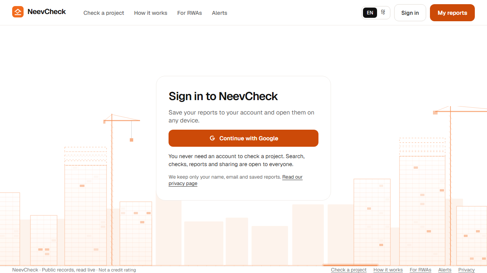
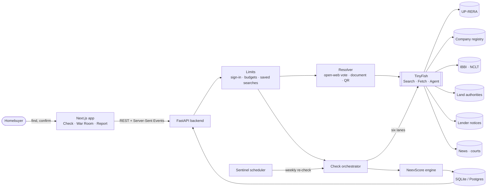
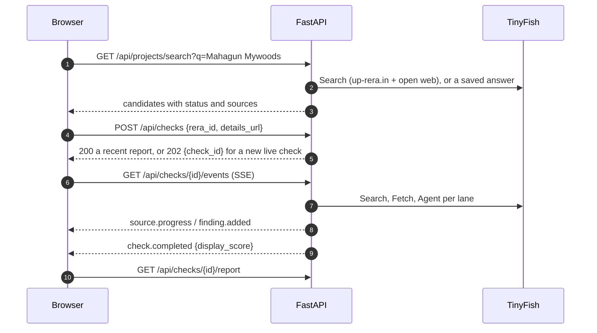

<div align="center">


<br>

[](https://neevcheck-up.vercel.app)
[](#team)
[](https://tinyfish.ai)
[](https://nextjs.org)
[](https://fastapi.tiangolo.com)
[](https://www.python.org)
[](LICENSE)

**A risk check for under-construction homes in Uttar Pradesh.** Search a UP-RERA project. TinyFish browser agents read six kinds of public records, and the app turns them into one **NeevScore (300–900)** with a source link for every point.

[**Live demo**](https://neevcheck-up.vercel.app) · [Scope](#scope-up-rera-only) · [Pages](#pages) · [How it works](#how-it-works) · [NeevScore](#neevscore-300900) · [Accounts](#sign-in-saved-reports-and-alerts) · [Credit protection](#credit-protection) · [Configuration](#configuration) · [Run it](#getting-started) · [Team](#team)

<br>


</div>

---

## Live demo

**Web app: <https://neevcheck-up.vercel.app>** · API: <https://neevcheck-api.onrender.com> ([health](https://neevcheck-api.onrender.com/api/health), [docs](https://neevcheck-api.onrender.com/docs)).

Every check is live: nothing is mocked, and there is no demo mode. The API runs on Render's free plan and sleeps when idle, so the first search can take up to a minute while it wakes. To run it yourself, see [Getting started](#getting-started); to deploy it, see [`docs/deployment.md`](docs/deployment.md).

## The problem

Buying an under-construction flat is often a family's biggest cheque. The facts that decide whether it will be delivered are public, but they are scattered across government portals that few buyers know about, let alone read.

| | |
| --- | --- |
| **51,000** | homes Supertech booked for delivery in 2010–12, many still waiting ([Supreme Court, Feb 2026](https://www.livelaw.in/top-stories/supreme-court-upholds-nclat-order-directing-nbcc-to-complete-stalled-supertech-housing-projects-522030)) |
| **49,748** | homes in 16 stalled Supertech projects handed to NBCC to finish ([NCLAT order, Dec 2024](https://psuwatch.com/newsupdates/nbcc-appointed-as-consultant-to-complete-supertechs-16-housing-projects)) |
| **UP-RERA** | the one register NeevCheck reads in full: promoter, dates, extensions and complaint counts for every project |

A broker's brochure says *"possession on time"*. The records may say the completion date was extended three times. NeevCheck reads the records so the buyer doesn't have to.

## Scope: UP-RERA only

NeevCheck covers **Uttar Pradesh RERA projects**, numbers like `UPRERAPRJ8334`. A number of another state's RERA, or a project in another state, gets one calm line: *"NeevCheck covers Uttar Pradesh RERA projects for now. Check this project on its own state's RERA website."* Nothing is searched for it.

**Why not other states?** UP-RERA is the one portal whose project pages a program can open and read: the details page, the project summary with its complaint counts, and the extensions granted. Other states' portals ask for a CAPTCHA or limit access, and NeevCheck never bypasses either. Thin, search-only coverage of them would look like a check and prove nothing, so it is left out.

Beyond UP-RERA, a check reads the company registry, group companies, insolvency orders, land authority lists, lender notices, news and court reports for the builder. A source it cannot read stays unread: that lowers confidence and never adds or removes points.

## Pages

| Page | What it is |
| --- | --- |
| **Home** `/` | The headline, the search box, *More ways to find it*, example searches, and your own recent checks |
| **Check a project** `/check` | Search, *More ways to find it* (builder, locality, brochure PDF, QR code, orders), saved reports of famous projects, what a check reads and what it costs |
| **How it works** `/how-it-works` | The steps, the six pillars and weights, the 300–900 scale and bands, what *Not enough evidence yet* means, and every source with its link |
| **For RWAs** `/rwa` | How a residents' group watches a project with Neev Sentinel, alerts with stop links, and a sign-in prompt |
| **Alerts** `/alerts` | The signed-in account's watches and alerts |
| **Privacy** `/privacy` | What is kept about a visitor, and how to remove it |
| **Login** `/login` | Optional Google sign-in |
| **Report** `/report/<id>`, **My reports** `/reports`, **Compare** `/compare` | A finished check, your saved checks, and projects side by side |

Every page has an English and a हिंदी version, chosen with the EN / हिं switch. Old links to `/#search`, `/#how-it-works` and `/#sentinel` go to the new pages.

<div align="center">

<br><sub><b>Login</b>: optional. You never need an account to read a saved report.</sub>
</div>

## How it works

<div align="center">

</div>

1. **Find it.** By name, UP-RERA number, builder, locality, a brochure PDF or a QR code. Many projects have no website and no number to hand; [there is a path for them](#find-a-project).
2. **Confirm it.** Candidates are listed with how sure we are of each number. Nothing runs until the buyer says *"yes, this is the one"*.
3. **War Room.** Six lanes, read two at a time: UP-RERA, the company registry, group companies, insolvency and court cases, land authorities, news and lenders. Each lane streams its progress and says honestly when it stopped.
4. **NeevScore.** A deterministic formula turns the findings into a 300–900 score. Same records, same score.
5. **Report.** Score, reasons, evidence ledger, timeline and a buyer action plan, in English or हिंदी.
6. **Sentinel.** A weekly re-check alerts the buyer only when a record actually changes.

<div align="center">

<br><sub><b>Report</b>: the score, the reasons behind it and the proof for each.</sub>
</div>

<div align="center">

<br><sub><b>War Room</b>: a recorded check of <code>UPRERAPRJ8334</code>, replayed. Six lanes, each with its own status.</sub>
</div>

The screenshots and animations above come from a local production build that replays saved fixtures. They never call TinyFish.

## Find a project

A buyer may know only a name, a builder's brand, a neighbourhood, a brochure or a hoarding's QR code. The search reads UP-RERA and the open web side by side, and never calls a listing site a source: listing sites only help find the number.

| You have | What NeevCheck does |
| --- | --- |
| **A name** | Searches up-rera.in, and the open web with no domain limit. `UPRERAPRJ` numbers are found in the results, then **voted on** |
| **A UP-RERA number** | Opens its own up-rera.in page. If the page gives nothing, the same vote confirms the number exists |
| **A builder** | The builder's registered projects from up-rera.in and the open web, plus company-registry pages with CIN, each company kept apart |
| **A city or locality** | The place is added to the open-web search |
| **A brochure or agreement** | Upload a PDF (5 MB). It is read in memory, the UP-RERA numbers and the words around them come back with phone numbers, e-mail, PAN and Aadhaar removed, and the file is never stored |
| **A QR code** | Scan it with the camera or choose a photo. The browser decodes it; only the text inside is sent |

**The vote.** A number printed by a page of up-rera.in earns 3 points, by the builder's own site 2, and by any other distinct domain 1. A number is kept at 3 points or when two domains print it, and only if one of them prints it next to the project's name. A number beside a *different* project's name does not count. Several numbers for one name (phases, towers) are separate candidates.

| Status | Meaning |
| --- | --- |
| `confirmed` | A page on up-rera.in prints this number |
| `listings_only` | Builder and listing sites print it; no UP-RERA page was read. A check will try UP-RERA and say what it could not verify |
| `from_document` | Taken from the buyer's own PDF or QR code |
| `from_order` | Found in a public order that names the project, with a link to the order |

**When nothing is found.** NeevCheck says only: *"We couldn't find a RERA registration for this project in public records."* It never calls a project illegal or unregistered, because a public search can miss a project. It then tells the buyer what to do: ask the builder for the number in writing, that a project of more than 500 square metres of land or more than eight apartments must be registered before it is advertised or sold (RERA Act, Section 3), not to pay until the number can be verified, and where to tell UP-RERA. A test bans accusing words in that card, in English and Hindi.

## NeevScore (300–900)

NeevScore v2 is a number from **300 to 900**: higher is safer. The backend owns the scale (`GET /api/meta` serves it; the frontend keeps no copy). It follows the shape of a credit report:

```text
NeevScore = 900 − 6 × Σ (pillar weight × pillar penalty)        clipped to 300–900
```

Points come off only for records we find. **Absence of a record never adds points.** A source we cannot read becomes reason code **R12 Data unavailable**: it costs nothing and lowers **confidence**, the share of the six pillars that were read.

| Pillar | Weight | Examples |
| --- | --: | --- |
| Regulatory compliance (RERA) | 30% | registration status, extensions, missed quarterly updates |
| Legal and insolvency | 25% | insolvency of the promoter or this project, complaints, cases |
| Delivery track record | 20% | complaints against the builder, other projects of the same group delayed or lapsed |
| Financial and corporate health | 15% | struck-off or disqualified directors, charges, auction notices |
| Land authority and approvals | 5% | dues lists, missing completion or occupancy certificates |
| Sentiment and news | 5% | delay or protest coverage (secondary, capped) |

| Band | Range |
| --- | --- |
| Low risk | 750–900 |
| Watch | 600–749 |
| Elevated risk | 450–599 |
| High risk | 300–449, and any hard stop (for example this project in insolvency per an official page) caps the score here |
| Not enough evidence yet | shown instead of a band, with a dash |

**Not enough evidence yet.** A band is shown only when the UP-RERA record (the first pillar) and at least four of the six pillars were read. Below that there is no number, because a number nobody can stand behind is worse than none. A hard stop always shows.

**Partly read pillars.** The complaint counts on UP-RERA's own summary page speak for the builder (the delivery track record pillar) and for the project (the legal pillar). When they are all that was read for a pillar, the report says *Partly read (UP-RERA complaints)*. They are a real record, so the pillar counts as read; the rest of it stays unread.

**A real example.** The recorded live check of `UPRERAPRJ8334` (Supertech Eco Village-I Phase I-C, read on 25 Oct 2026), the report in the screenshot above, gave **495 · Elevated** with 5 of 6 pillars read:

```text
900  starting score
-150 15 complaints on UP-RERA about this project            (R05, primary)
-126 completion date 105 months after the promised one      (R03, primary)
-120 5 of 5 group projects past their completion date       (R13, primary)
  -9 three news stories on delays                           (R11, secondary)
 ───
 495  Elevated · confidence 83% (5 of 6 pillars) · no hard stop
      not read: land authority and e-Jagriti (R12), listed with a link to check by hand
```

The 2,803 complaints against the promoter across all its projects are also a finding (R13, "Builder complaint record", capped); here the group's delays already use up that pillar. Every line links to the page it was read from. The check is recorded in [`frontend/e2e/fixtures/report.json`](frontend/e2e/fixtures/report.json) and replayed by the browser tests; the backend tests replay [`backend/tests/fixtures/check_8334.json`](backend/tests/fixtures/check_8334.json). The weights are transparent expert priors, to be calibrated on labelled stalled-project lists. Full method: [`docs/scoring.md`](docs/scoring.md).

## Sign-in, saved reports and alerts

Google sign-in is **optional**. Checking a project, reading a saved report and sharing one never need it.

- **Separate accounts.** Reports and alerts belong to one Google account. Another account on the same browser sees none of them, and nobody sees anyone else's checks.
- **Saved reports.** Signed in, every check you start or reuse is saved to your account. Signed out, they stay in this browser and can be moved into an account later.
- **Alerts with stop links.** Watch a project with Neev Sentinel and it is re-checked every week. An alert is created only when a record changed, in English or हिंदी, and every alert email ends with a link that stops that one watch. An account can watch 3 projects.
- **What is kept.** A Google id, a name, an e-mail and the ids of your reports. Delete it all from the account menu. See `/privacy`.

## Credit protection

Every live check and search spends TinyFish credit, so each has a limit. All of them are environment variables ([the table below](#configuration)); days and months are counted in Indian time.

- **Sign in to start a live check.** A new live check needs a Google sign-in, and an account gets 2 a day. Opening, sharing and reusing saved reports stays open to everyone.
- **Reuse of recent reports.** A report finished in the last 7 days is returned to anyone instead of starting a new check, at no cost. *Re-check now* works once per project every 7 days, and the report shows *Next re-check possible on …* until then.
- **Saved searches.** A search answer (a name, a builder, a locality or a RERA number) is kept in the database for 7 days, so the same query never calls Search twice. Searches per address are limited to 15 a day signed out and 40 signed in; a saved answer does not count.
- **Daily and monthly budgets.** The whole site starts at most 5 live checks a day and 60 a month, Sentinel's re-checks included. When they are used up the site says *"Today's live checks are used up. Saved reports are still open; new checks open again tomorrow."* Searching and opening saved reports keep working.
- **Invite-only switch.** With `INVITE_ONLY=true`, only the e-mails in `ALLOWED_EMAILS` can start live checks; everyone else still reads saved reports.
- **Lanes that cannot succeed are not run.** Consumer cases (e-Jagriti) always show a CAPTCHA, so no agent is sent: the lane says *Not checked automatically: the site needs a CAPTCHA* and links to the site. The group lane runs only when UP-RERA gives the builder's exact company name. The insolvency lane reads its page with Fetch first and sends an agent only when the page speaks of an admission.
- **A stop when credit runs out.** If TinyFish reports no credit left or a rate limit, the rest of that check's lanes are skipped, with no retries, and the War Room says *Paused: live-check credits are low*.
- **What a check costs.** Each check stores how many Search, Fetch and Agent calls it made. `GET /api/admin/usage` (with `ADMIN_TOKEN`) returns today's and this month's totals and the average per check.

## How NeevCheck uses TinyFish

Every source tries the cheapest way to read a page first and escalates only when it has to.

| TinyFish | Used for |
| --- | --- |
| **Search** | Finding the project on the open web and on up-rera.in; company pages; lender notices; news; public orders |
| **Fetch** | Opening UP-RERA project pages, company-registry pages and PDFs, lender and land-authority documents |
| **Agent** | The last step, for a page that needs clicks, such as an insolvency order that speaks of an admission |
| **Monitors** | Watching a project's page and builder news; a change re-checks and alerts |

When an agent meets a CAPTCHA, a login or a paywall it stops. The lane says *Unable to verify*, the report lowers confidence, and nothing is bypassed. Results are cached per source, entity and day, so a second project of the same builder reads its company records from the cache. The escalation ladder is in [`docs/architecture.md`](docs/architecture.md#the-escalation-ladder).

## Architecture

<div align="center">

</div>

<details>
<summary><b>Diagram source</b> (Mermaid)</summary>





</details>

More detail in [`docs/architecture.md`](docs/architecture.md).

## Tech stack

| Layer | Choice | Why |
| --- | --- | --- |
| Browser agents | **TinyFish** Search, Fetch, Agent and Monitors | Reads real government portals like a person, with a live view we can show buyers |
| Frontend | **Next.js 15**, React 19, TypeScript (strict) | Server rendering for a fast first load, file-based routes |
| Styling | Plain CSS with design tokens, CSS animations | Easy to read; no runtime animation library |
| Fonts | Geist, Geist Mono, Noto Sans Devanagari (self-hosted) | Clean UI type with proper Hindi support, and builds that never fetch fonts |
| Backend | **Python 3.12, FastAPI**, Pydantic v2 | Typed API, async streaming with Server-Sent Events |
| Documents | pypdf (PDF text), jsQR (QR codes, in the browser) | Small, pinned, offline; no OCR service |
| Accounts | Auth.js with Google, a short-lived signed token to the API | One login system; the API only checks a signature |
| Storage | SQLite (local), Postgres (production) via SQLAlchemy 2 | Zero setup locally, one switch to deploy |
| Quality | pytest, Ruff, ESLint, tsc, Playwright with axe | Every change linted, typed, tested and checked for accessibility |
| CI and security | GitHub Actions, gitleaks, Dependabot | Tests on every push, secret scan over full history |
| Hosting | Vercel (web), Render (API) | Free tiers |

## Trust and ethics

- **Public records only.** NeevCheck reads official portals and published reports. No private data is collected; an uploaded brochure is read in memory and never stored.
- **No CAPTCHA, login or paywall is ever bypassed.** The source is marked *Unable to verify*, or *Not checked automatically* when we know it always shows a CAPTCHA.
- **No source, no claim.** Every finding links to where it came from and when it was read. A fact from news or another secondary source is badged *From a secondary source*, never *Confirmed*. Listing sites, orders and uploads only help find a project's number and builder; they are never scored findings.
- **Absence adds nothing.** A record we could not find never adds points; an unreadable source only lowers confidence.
- **Never invented.** There is no demo mode: every check is live, and tests replay recorded fixtures only.
- **Decision support, not advice.** NeevCheck is not a credit rating or legal advice. Verify important facts on the official portal.
- **Your keys stay yours.** API keys live in a local `.env`, never in the browser, logs or commits. See [`SECURITY.md`](SECURITY.md).

## Getting started

> Every check is live, so you need a [TinyFish API key](https://agent.tinyfish.ai/api-keys). To put NeevCheck online, follow [`docs/deployment.md`](docs/deployment.md).

```bash
git clone https://github.com/Nitinmittal373/HACKATHON_IIIT-DELHI_2026.git neevcheck
cd neevcheck
cp .env.example .env            # then set TINYFISH_API_KEY in .env

# backend
cd backend
python -m venv .venv && source .venv/bin/activate
pip install -r requirements-dev.txt
uvicorn app.main:app --reload    # http://localhost:8000/docs
ruff check . && pytest -q        # tests replay recorded responses, no key needed

# frontend (new terminal)
cd frontend
npm install
npm run dev                      # http://localhost:3000
npm run lint && npm run typecheck && npm run test:unit && npm run build
npm run e2e                      # browser tests; need `npx playwright install chromium` once

# after changing a backend model (from the repo root)
make contract                    # exports contracts/openapi.json and regenerates the frontend types
```

The key never leaves your machine: `.env` is git-ignored and the app never logs it. A `TINYFISH_API_KEY` set in your shell takes precedence over `.env`. For local work without Google sign-in, set `REQUIRE_SIGNIN_FOR_CHECKS=false` in `.env`.

Try it from the terminal once the backend is running:

```bash
curl "localhost:8000/api/projects/search?q=Mahagun%20Mywoods"
curl "localhost:8000/api/promoters/search?q=Mahagun%20India"
curl -X POST localhost:8000/api/extract -H "Content-Type: application/pdf" --data-binary @brochure.pdf
curl -X POST localhost:8000/api/checks -H "Content-Type: application/json" -d '{"rera_id": "UPRERAPRJ8334"}'
curl -N localhost:8000/api/checks/<id>/events               # live event stream
curl localhost:8000/api/checks/<id>/report
curl localhost:8000/api/limits                              # what a live check costs
```

The full API is described in [`docs/architecture.md`](docs/architecture.md#api).

To refresh the README pictures without spending any credit: build the app, start the recorded API (`node e2e/mock-api.ts`), point the site at it with `NEXT_PUBLIC_API_URL`, then run `npm run capture` in `frontend/`.

## Configuration

Set the **Render** values on the API service and the **Vercel** values on the web app. Secrets are marked; their values are never shown here, never put in a `NEXT_PUBLIC_` variable and never committed (`.env` is git-ignored). The full guide is [`docs/deployment.md`](docs/deployment.md).

### Render (API)

| Variable | Default | Secret | What it does |
| --- | --- | :-: | --- |
| `TINYFISH_API_KEY` | required | yes | Your TinyFish key. Only the API ever sees it |
| `FRONTEND_ORIGINS` | `http://localhost:3000` | | Web addresses allowed to call the API, comma separated |
| `AUTH_BRIDGE_SECRET` | unset | yes | Same value as on Vercel. Without it sign-in and saved reports are off |
| `WEBHOOK_SECRET` | unset | yes | Protects `POST /api/sentinel/run` and the monitor webhook |
| `ADMIN_TOKEN` | unset | yes | Sent as `X-Admin-Token` to read `GET /api/admin/usage`. Unset, that route is off |
| `DATABASE_URL` | SQLite file | yes | A Postgres URL keeps data across deploys |
| `SMTP_PASSWORD` | unset | yes | Password for alert e-mail |
| `REQUIRE_SIGNIN_FOR_CHECKS` | `true` | | A new live check needs a sign-in |
| `CHECKS_PER_ACCOUNT_PER_DAY` | `2` | | Live checks one account may start per day |
| `SITE_CHECKS_PER_DAY` | `5` | | Live checks the whole site may start per day |
| `SITE_CHECKS_PER_MONTH` | `60` | | The same, per month |
| `REUSE_REPORT_DAYS` | `7` | | A report this recent is shown instead of checking again |
| `RECHECK_MIN_DAYS` | `7` | | *Re-check now* works once per project in this many days |
| `SEARCH_CACHE_DAYS` | `7` | | How long a search answer is kept |
| `SEARCHES_PER_IP_PER_DAY` | `15` | | Searches per address per day, signed out |
| `SEARCHES_PER_IP_PER_DAY_SIGNED_IN` | `40` | | The same, signed in |
| `INVITE_ONLY` | `false` | | Only `ALLOWED_EMAILS` may start live checks |
| `ALLOWED_EMAILS` | empty | | Comma-separated e-mails for the invite-only switch |
| `FEATURED_RERA_IDS` | empty | | UP-RERA numbers for the gallery on the Check page; only those with a saved check show |
| `RATE_LIMIT_PER_MINUTE` | `6` | | Check creation per address per minute |
| `AGENT_CONCURRENCY` | `2` | | Browser agents at the same time |
| `AGENT_TIMEOUT_SECONDS` | `300` | | Longest one agent may run |
| `AGENT_SEND_MAX_STEPS` | `false` | | Send a step limit with each run (TinyFish beta accounts only) |
| `FETCH_TIMEOUT_SECONDS` | `60` | | Longest one Fetch may take |
| `SENTINEL_INTERVAL_HOURS` | `168` | | Hours between re-checks of watched projects; `0` turns it off |
| `TRUST_FORWARDED_FOR` | `true` on Render | | Read the visitor's address from the proxy header |
| `PUBLIC_BASE_URL` | unset | | The API's own address, for TinyFish Monitors |
| `SITE_URL` | unset | | The web app's address, for the stop link in alert e-mails |
| `SMTP_HOST`, `SMTP_PORT`, `SMTP_USER`, `SMTP_FROM` | unset, port `587` | | Optional e-mail delivery of alerts |

### Vercel (web app)

| Variable | Default | Secret | What it does |
| --- | --- | :-: | --- |
| `NEXT_PUBLIC_API_URL` | `http://localhost:8000` | | The API's address, no trailing slash |
| `NEXT_PUBLIC_SITE_URL` | `http://localhost:3000` | | The site's own address, for links and share previews |
| `NEXTAUTH_URL` | unset | | The site's address, for Google sign-in |
| `AUTH_SECRET` | unset | yes | Long random string that signs the sign-in session |
| `AUTH_GOOGLE_ID` | unset | | Google OAuth client id |
| `AUTH_GOOGLE_SECRET` | unset | yes | Google OAuth client secret |
| `AUTH_BRIDGE_SECRET` | unset | yes | Same value as on Render |

Without the Google settings the site works as before and `/login` says sign-in is not set up.

## Project structure

```text
.
├── backend/                 FastAPI service
│   ├── app/
│   │   ├── api/             routes: search, promoters, extract, checks, events (SSE), reports, limits, admin, sentinel
│   │   ├── sources/         one module per public source, plus the shared agent runner
│   │   ├── states/          the resolver, the open-web vote, UP-RERA confirmation, builder and order search
│   │   ├── budget.py        the site, account and re-check limits
│   │   ├── search_gate.py   saved search answers and the per-address search limit
│   │   ├── usage.py         counts TinyFish calls per check and stops them when credit runs out
│   │   ├── extract.py       numbers in a PDF or QR text, with personal details removed
│   │   ├── scoring/         NeevScore engine (v2/) and the classic 0–100 score
│   │   ├── sentinel/        watches, change detection, alerts, email
│   │   ├── orchestrator.py  runs a check and streams its events
│   │   └── tinyfish.py      the only module that calls TinyFish
│   ├── scripts/             API contract export; recorders for test fixtures
│   └── tests/               pytest, with recorded TinyFish responses in fixtures/
├── frontend/                Next.js app
│   ├── e2e/                 Playwright tests against a recorded API
│   ├── scripts/             capture.ts: the README media, from recorded fixtures
│   └── src/
│       ├── app/             routes: home, check, how-it-works, rwa, alerts, privacy, login, report, reports, compare
│       ├── components/      pages/, find/ (More ways), confirm/, cam/ (War Room), report/ …
│       ├── lib/             API client and types generated from the contract, English and Hindi copy
│       └── styles/          tokens, globals, app screens and print
├── contracts/               openapi.json, exported from the backend (the API contract)
├── docs/                    architecture, scoring, data sources, deployment, assets
├── render.yaml              Render Blueprint for the API
└── .github/                 CI, issue forms, pull request template
```

## Roadmap

- [x] **Phase 0 · Foundation** — repo structure, CI, security policy, contribution guide, final design approved
- [x] **Phase 1 · Backend core** — API, data models, NeevScore engine, live UP-RERA source, event stream, shared agent runner
- [x] **Phase 2 · TinyFish agents** — source agents, live view streaming, CAPTCHA handling
- [x] **Phase 3 · Frontend foundation** — design tokens, layout, animated skyline, home page
- [x] **Phase 4 · Check flow** — search, confirm, Agent Cam, report
- [x] **Phase 5 · Sentinel and sharing** — weekly re-checks, alerts, PDF, Hindi
- [x] **v2 · Credit-style score** — NeevScore 300–900 with reason codes, War Room, family tree, evidence ledger, complaint draft, Monitor watch
- [x] **One contract, one score** — the API contract is exported from the backend and generates the frontend types
- [x] **Uttar Pradesh only** — one register read in full; other states answered with a calm line
- [x] **Find a project** — open-web search with source voting, UP-RERA confirmation, builder and locality search, brochure and QR, public orders, and factual guidance when nothing is found
- [x] **Accounts** — optional Google sign-in, separate saved reports and alerts with stop links
- [x] **Credit protection** — sign-in for live checks, reuse of recent reports, saved searches, daily and monthly budgets, an invite-only switch, and a stop when credit runs out
- [x] **Real pages** — Check, How it works and For RWAs have their own addresses, in English and हिंदी
- [ ] **Phase 6 · Launch** — deployment, calibration of the score weights, v1.0

## Team

Built by **Team RYZEN** from KIET Group of Institutions for the HackIIITD 2026 finale at IIIT Delhi.

| Member | Role | Focus |
| --- | --- | --- |
| <a href="https://github.com/Nitinmittal373"></a>**Nitin Mittal** (team leader)<br>[github.com/Nitinmittal373](https://github.com/Nitinmittal373) | Backend | Backend services and integrations |
| <a href="https://github.com/rishibhaskar777"></a>**Rishi Bhaskar**<br>[github.com/rishibhaskar777](https://github.com/rishibhaskar777) | Full-stack | Frontend and backend |
| **Siddharth Varshney** | UI/UX | Interface and experience design |
| **Shreyansh Gupta** | Architecture and idea | System architecture, design and the original idea |

Want to help? Read [`CONTRIBUTING.md`](CONTRIBUTING.md).

## License

[MIT](LICENSE) © 2026 Rishi Bhaskar and Nitin Mittal

<div align="center"><sub>Built on public records, read by TinyFish agents.</sub></div>
