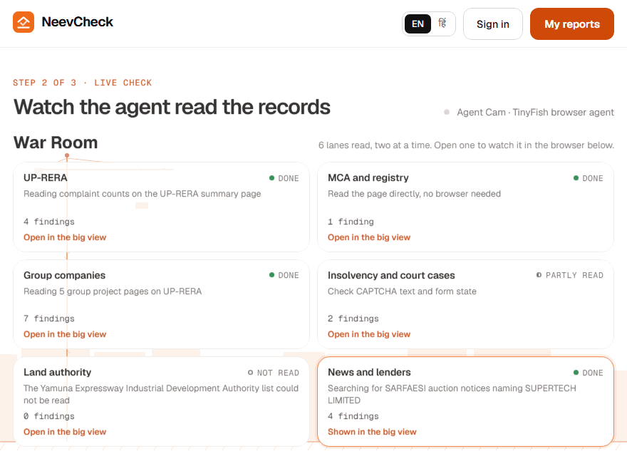
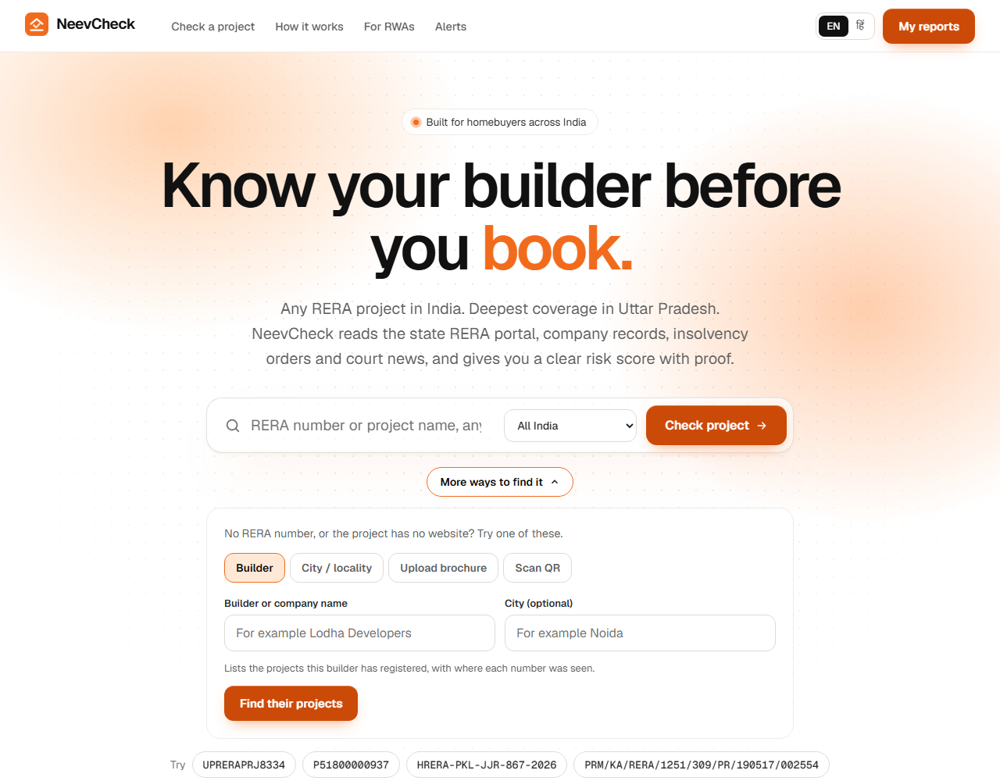
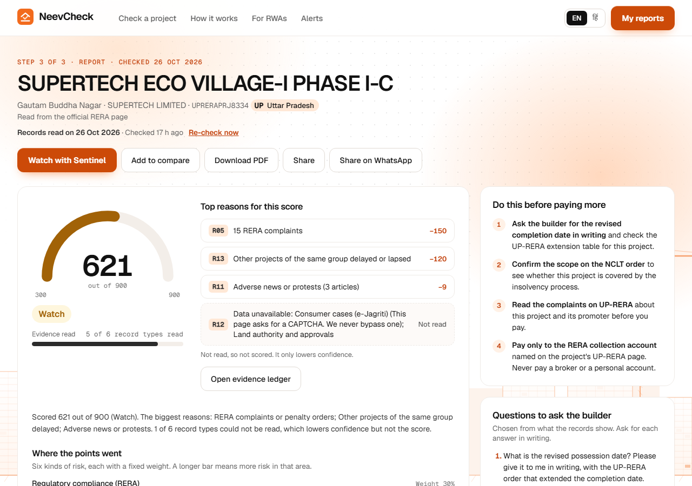
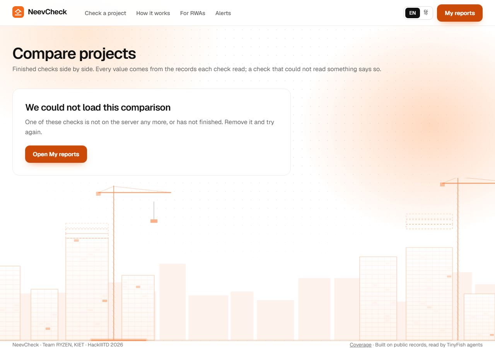
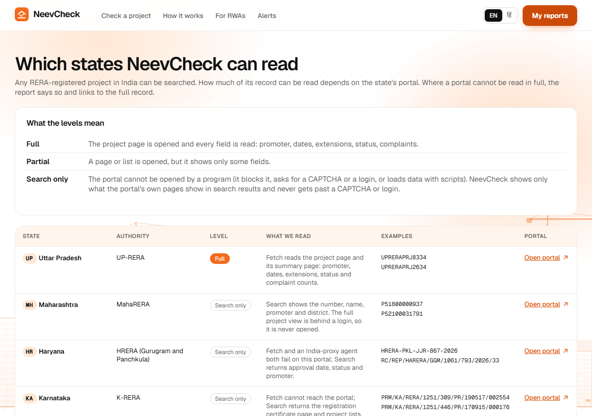
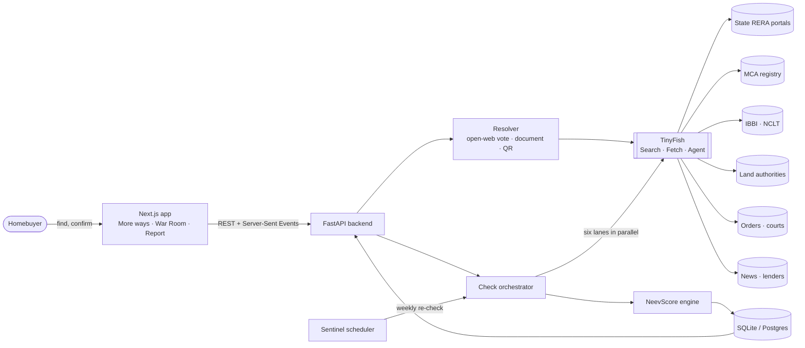
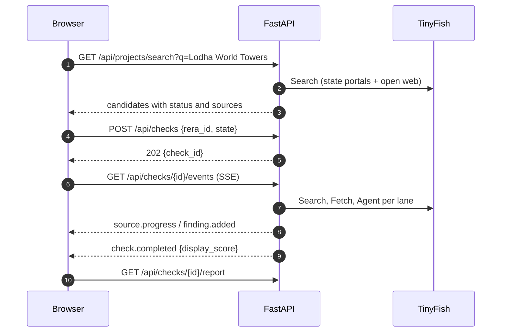

<div align="center">



<br>

[](#team)
[](https://tinyfish.ai)
[](https://nextjs.org)
[](https://fastapi.tiangolo.com)
[](https://www.python.org)
[](#all-india-coverage)
[](LICENSE)

**A risk check for under-construction homes in India.** Give NeevCheck a project, a builder, a brochure or a QR code. TinyFish browser agents read the public records, and the app turns them into one **NeevScore (300–900)** with a source link for every point.

[Find a project](#find-any-project-in-india) · [How it works](#how-it-works) · [NeevScore](#neevscore-300900) · [Architecture](#architecture) · [Run it](#getting-started) · [Team](#team)

<br>


</div>

---

## Live demo

The deployed web app and API follow [`docs/deployment.md`](docs/deployment.md) (Vercel and Render). Every check is live: nothing is mocked, and there is no demo mode. To run it yourself, see [Getting started](#getting-started).

## The problem

Buying an under-construction flat is often a family's biggest cheque. The facts that decide whether it will be delivered are public, but they are scattered across government portals that few buyers know about, let alone read.

| | |
| --- | --- |
| **51,000** | homes Supertech booked for delivery in 2010–12, many still waiting ([Supreme Court, Feb 2026](https://www.livelaw.in/top-stories/supreme-court-upholds-nclat-order-directing-nbcc-to-complete-stalled-supertech-housing-projects-522030)) |
| **49,748** | homes in 16 stalled Supertech projects handed to NBCC to finish ([NCLAT order, Dec 2024](https://psuwatch.com/newsupdates/nbcc-appointed-as-consultant-to-complete-supertechs-16-housing-projects)) |
| **23** | state and territory RERA portals, each with its own number format, gates and layout |

A broker's brochure says *"possession on time"*. The records may say the completion date was extended three times. NeevCheck reads the records so the buyer doesn't have to.

## How it works

<div align="center">

</div>

1. **Find it.** By name, RERA number, builder, locality, a brochure PDF or a QR code. Many projects have no website and no number to hand; [there is a path for them](#find-any-project-in-india).
2. **Confirm it.** Candidates are listed with how sure we are of each number. Nothing runs until the buyer says *"yes, this is the one"*.
3. **War Room.** Six lanes read in parallel: the state's RERA portal, the company registry, group companies, insolvency and court cases, land authorities, news and lenders. Each lane streams its progress and says honestly when it stopped.
4. **NeevScore.** A deterministic formula turns the findings into a 300–900 score. Same records, same score.
5. **Report.** Score, reasons, evidence ledger, timeline and a buyer action plan, in English or हिंदी.
6. **Sentinel.** A weekly re-check alerts the buyer only when a record actually changes.

<div align="center">

<br><sub><b>War Room</b>: a real check of <code>UPRERAPRJ8334</code>, sped up. Six lanes, each with its own status.</sub>
</div>

## Find any project in India

A buyer may know only a name, a builder's brand, a neighbourhood, a brochure or a hoarding's QR code. NeevCheck takes all six. The search runs the state portals and the open web side by side, and never calls a listing site a source: listing sites only help find the number.

| You have | What NeevCheck does |
| --- | --- |
| **A name** | Searches every state portal, and the open web with no domain limit (four Search wordings, cached for a day). Numbers are found with every state's format, then **voted on** |
| **A RERA number** | The format names the state; only that portal is asked. If the portal gives nothing, the same vote confirms the number exists |
| **A builder** | `GET /api/promoters/search`: the builder's registered projects from the state portals and the open web, plus company-registry pages with CIN, each company kept apart |
| **A city or locality** | `?locality=Sector 150 Noida` picks the state from a table of about 150 cities and areas, so only that portal is read |
| **A brochure or agreement** | Upload a PDF (5 MB). It is read in memory, the numbers and the words around them come back with phone numbers, e-mail, PAN and Aadhaar removed, and the file is never stored |
| **A QR code** | Scan it with the camera or choose a photo. The browser decodes it; only the text inside is sent |

<div align="center">

<br><sub><b>More ways to find it</b>: builder, locality, brochure upload and QR scan. Keyboard accessible, English and हिंदी.</sub>
</div>

**The vote.** A number printed by a page of that state's RERA domain earns 3 points, by the builder's own site 2, and by any other distinct domain 1. A number is kept at 3 points or when two domains print it, and only if one of them prints it next to the project's name. A number beside a *different* project's name does not count (a listing of many projects gives each number only its own words), and plain formats such as `112 of 2021` need the word RERA beside them. Several numbers for one name (phases, towers) are separate candidates.

**What the buyer is told.** Every candidate carries a status and the sites that printed its number:

| Status | Meaning |
| --- | --- |
| `confirmed` | A page on the state's RERA portal prints this number |
| `listings_only` | Builder and listing sites print it; no portal page was read. A check will try the portal and say what it could not verify |
| `from_document` | Taken from the buyer's own PDF or QR code |
| `from_order` | Found in a public order that names the project, with a link to the order |
| *pre-RERA note* | Public pages say the project was delivered before RERA. The card quotes the page and offers the builder's registered projects; **no project score is given** |

<div align="center">

<br><sub><b>Confirm</b>: Lodha World Towers has two MahaRERA numbers. Each row says whether a portal prints it, or on which sites it was seen. (Live capture, 27 Oct 2026.)</sub>
</div>

**When nothing is found.** NeevCheck says only: *"We couldn't find a RERA registration for this project in public records."* It never calls a project illegal or unregistered, because a public search can miss a project. It then tells the buyer what to do: ask the builder for the number in writing, that a project of more than 500 square metres of land or more than eight apartments must be registered before it is advertised or sold (RERA Act, Section 3), not to pay until the number can be verified, and where to tell the state's RERA (for example UP-RERA's form for projects without a registration). A test bans accusing words in that card, in English and Hindi.

## What NeevCheck does

| | Feature | What the buyer gets |
| :-: | --- | --- |
| 🔎 | **Find any project** | Name, number, builder, locality, brochure or QR code, across 23 state and territory portals and the open web |
| 🏟️ | **War Room** | Six lanes read in parallel, each with its own live ticker and findings count; click a lane to enlarge its live browser view |
| 📊 | **NeevScore (300–900)** | One explained number, like a credit score: six weighted pillars, a confidence meter and reason codes R01–R14 |
| 🗂️ | **Evidence ledger** | Every finding carries its source link, the minute it was read, the words on the page and its reliability. *No source, no claim.* |
| 🧬 | **Builder DNA and family tree** | Sister projects, insolvency scope, directors (name and DIN only) and related companies, with a list view for phones |
| ⚖️ | **Compare** | Two or three projects side by side; it names the best only when the evidence allows |
| ✅ | **Buyer action plan and questions** | Four things to check before paying more, and five questions for the builder, ready to copy |
| ✉️ | **Complaint draft** | An editable complaint built from facts only, with numbered annexures, in English or Hindi. *Draft for you to review. Not legal advice.* |
| 🔔 | **Neev Sentinel** | Weekly re-checks and TinyFish Monitors on the project's page; an alert only when a record changes |
| 🗃️ | **My reports** | Every check is kept in your browser, with no account |
| 🌐 | **English and हिंदी** | Plain-language reports for every family member |

<div align="center">

<br><sub><b>Report</b>: the score, the reasons behind it and the proof for each.</sub>
</div>

<table>
<tr>
<td width="50%"><br><sub><b>Compare</b>: row by row from the records. A thin check is never ranked.</sub></td>
<td width="50%"><br><sub><b>Coverage</b>: every state portal and how deeply it is read.</sub></td>
</tr>
</table>

## NeevScore (300–900)

NeevScore is a number from **300 to 900**: higher is safer. The backend owns the scale (`GET /api/meta` serves it; the frontend keeps no copy). It follows the shape of a credit report:

```text
NeevScore = 900 − 6 × Σ (pillar weight × pillar penalty)        clipped to 300–900
```

Points come off only for records we find. **Absence of a record never adds points.** A source we cannot read becomes reason code **R12 Data unavailable**: it costs nothing and lowers **confidence**, the share of the six record types that were read.

| Pillar | Weight | Examples |
| --- | --: | --- |
| Regulatory compliance (RERA) | 30% | registration status, extensions, missed quarterly updates |
| Legal and insolvency | 25% | insolvency of the promoter or this project, complaints, cases |
| Delivery track record | 20% | other projects of the same group delayed or lapsed |
| Financial and corporate health | 15% | struck-off or disqualified directors, charges, auction notices |
| Land authority and approvals | 5% | dues lists, missing completion or occupancy certificates |
| Sentiment and news | 5% | delay or protest coverage (secondary) |

| Band | Range |
| --- | --- |
| Low risk | 750–900 |
| Watch | 600–749 |
| Elevated risk | 450–599 |
| High risk | 300–449, and any hard stop (for example this project in insolvency per an official page) caps the score here |
| Not enough evidence yet | shown instead of a band, with a dash, while fewer than half the six record types were read |

**A real example.** A live check of `UPRERAPRJ8334` (Supertech Eco Village-I Phase I-C), first read on 25 Oct 2026 and read again on 26 Oct 2026 with the same result, with every source on, gave **621 · Watch** with 5 of 6 record types read:

```text
900  starting score
-150 15 complaints on UP-RERA about this project            (R05, primary)
-120 5 of 5 group projects past their completion date       (R13, primary)
  -9 three recent news stories on delays                    (R11, secondary)
 ───
 621  Watch · confidence 83% (5 of 6 record types) · no hard stop
```

Every line links to the page it was read from; the check is recorded in [`backend/tests/fixtures/check_8334.json`](backend/tests/fixtures/check_8334.json) and replayed by the tests. The weights are transparent expert priors, to be calibrated on labelled stalled-project lists. Full method: [`docs/scoring.md`](docs/scoring.md).

## All-India coverage

How much of a record can be read depends on the state's portal, and the app says so on every result and report. The research behind these levels is in [`docs/states.md`](docs/states.md); the live table is the `/coverage` page.

| Level | Meaning | States |
| --- | --- | --- |
| **Full** | Fetch opens the project page and a parser reads every field | Uttar Pradesh |
| **Partial** | A page or list is opened, but it shows only some fields | Goa, Bihar, Jharkhand |
| **Search only** | The portal blocks programs, asks for a CAPTCHA or login, or loads data with scripts. NeevCheck shows only what the portal's own pages print in search results (marked "search snippet" in the ledger) and links to the full record | Maharashtra, Haryana, Karnataka, Delhi, Telangana, Gujarat, Tamil Nadu, Rajasthan, Madhya Pradesh, West Bengal, Punjab, Kerala, Andhra Pradesh, Uttarakhand, Odisha, Chhattisgarh, Himachal Pradesh, Assam, Jammu and Kashmir |

A field a portal does not show stays unread: it lowers confidence and never adds penalty points. The company registry, insolvency, group companies, lender notices and news are read for every state. Land dues lists exist for Uttar Pradesh only. Telangana and Madhya Pradesh are marked "format not yet verified" because no real number has been read from their portals.

## How NeevCheck uses TinyFish

Every source tries the cheapest way to read a page first and escalates only when it has to.

| TinyFish | Cost | Used for |
| --- | --- | --- |
| **Search** | free | Finding the project on the open web; reading what a state portal's own pages print; company pages; lender notices; news; public orders |
| **Fetch** | free | Opening UP-RERA project pages, Goa, Bihar and Jharkhand lists, company-registry pages and PDFs, lender and land-authority documents |
| **Agent** | paid, last step | Pages that need clicks: insolvency and court cases, e-Jagriti, the registry only when Fetch cannot read it. **A report uses at most three agent runs** |
| **Monitors** | per daily check | Watching a project's page and builder news; a change re-checks and alerts |

When an agent meets a CAPTCHA, a login or a paywall it stops. The lane says *Unable to verify*, the report lowers confidence, and nothing is bypassed. Results are cached per source, entity and day, so a second project of the same builder reads its company records from the cache. The escalation ladder is in [`docs/architecture.md`](docs/architecture.md#the-escalation-ladder).

## Architecture

<div align="center">

</div>

<details>
<summary><b>Diagram source</b> (Mermaid)</summary>





</details>

More detail in [`docs/architecture.md`](docs/architecture.md).

## Tech stack

| Layer | Choice | Why |
| --- | --- | --- |
| Browser agents | **TinyFish** Search, Fetch, Agent and Monitors | Reads real government portals like a person, with a live view we can show buyers |
| Frontend | **Next.js 15**, React 19, TypeScript (strict) | Server rendering for a fast first load, file-based routes |
| Styling | Plain CSS with design tokens, CSS animations | Easy to read; no runtime animation library |
| Fonts | Geist, Geist Mono, Noto Sans Devanagari | Clean UI type with proper Hindi support |
| Backend | **Python 3.12, FastAPI**, Pydantic v2 | Typed API, async streaming with Server-Sent Events |
| Documents | pypdf (PDF text), jsQR (QR codes, in the browser) | Small, pinned, offline; no OCR service |
| Storage | SQLite (local), Postgres (production) via SQLAlchemy 2 | Zero setup locally, one switch to deploy |
| Quality | pytest, Ruff, ESLint, tsc, Playwright with axe | Every change linted, typed, tested and checked for accessibility |
| CI and security | GitHub Actions, gitleaks, Dependabot | Tests on every push, secret scan over full history |
| Hosting | Vercel (web), Render (API) | Free tiers that fit a hackathon demo |

## Trust and ethics

- **Public records only.** NeevCheck reads official portals and published reports. No private data is collected; an uploaded brochure is read in memory and never stored.
- **No CAPTCHA, login or paywall is ever bypassed.** The source is marked *Unable to verify*.
- **No source, no claim.** Every finding links to where it came from and when it was read. Listing sites, orders and uploads only help find a project's number and builder; they are never scored findings.
- **Absence adds nothing.** A record we could not find never adds points; an unreadable source only lowers confidence.
- **Never invented.** There is no demo mode: every check is live, and tests replay recorded fixtures only.
- **Decision support, not advice.** NeevCheck is not a credit rating or legal advice. Verify important facts on the official portal.
- **Your keys stay yours.** API keys live in a local `.env`, never in the browser, logs or commits. See [`SECURITY.md`](SECURITY.md).

## Where NeevCheck fits

| Tool | What it is known for | The gap NeevCheck owns |
| --- | --- | --- |
| Landeed, Terra | Land records and title checks | The land, not the builder's RERA delivery record, group companies or insolvency |
| Probe42, Tofler, Zauba | Company risk data and registry mirrors | Raw company data with no project score; NeevCheck reads them as one source among several |
| Property portals | Listings and builder marketing | No incentive to show risk |
| PropEquity, PropAlert | Market and project tracking and delay analytics | Aggregate views, not a sourced per-project proof for one buyer |
| CRISIL and other raters | Ratings of builders for lenders and investors | Paid and not aimed at buyers; NeevCheck is explicitly *not* a credit rating |
| A lawyer's verification | A one-off title and approvals opinion | Slow and rarely repeated; NeevCheck is a free first pass and a list of questions to take to the lawyer |

NeevCheck's gap: **a free, sourced, per-project risk check for a home buyer anywhere in India, with proof for every point, a way in for projects that have no website, and a complaint draft when the records show a problem.** Descriptions of other tools are brief summaries of what they are known for, not reviews.

## Getting started

> Every check is live, so you need a [TinyFish API key](https://agent.tinyfish.ai/api-keys). To put NeevCheck online, follow [`docs/deployment.md`](docs/deployment.md).

```bash
git clone https://github.com/Nitinmittal373/HACKATHON_IIIT-DELHI_2026.git neevcheck
cd neevcheck
cp .env.example .env            # then set TINYFISH_API_KEY in .env

# backend
cd backend
python -m venv .venv && source .venv/bin/activate
pip install -r requirements-dev.txt
uvicorn app.main:app --reload    # http://localhost:8000/docs
ruff check . && pytest -q        # tests replay recorded responses, no key needed

# frontend (new terminal)
cd frontend
npm install
npm run dev                      # http://localhost:3000
npm run lint && npm run typecheck && npm run test:unit && npm run build
npm run e2e                      # browser tests; need `npx playwright install chromium` once

# after changing a backend model (from the repo root)
make contract                    # exports contracts/openapi.json and regenerates the frontend types
```

The key never leaves your machine: `.env` is git-ignored and the app never logs it. A `TINYFISH_API_KEY` set in your shell takes precedence over `.env`.

Try it from the terminal once the backend is running:

```bash
curl "localhost:8000/api/projects/search?q=Lodha%20World%20Towers"
curl "localhost:8000/api/projects/search?q=Eureka%20Park&locality=Sector%20150%20Noida"
curl "localhost:8000/api/promoters/search?q=Lodha%20Developers"
curl -X POST localhost:8000/api/extract -H "Content-Type: application/pdf" --data-binary @brochure.pdf
curl -X POST localhost:8000/api/checks -H "Content-Type: application/json" -d '{"rera_id": "UPRERAPRJ8334"}'
curl -N localhost:8000/api/checks/<id>/events               # live event stream
curl localhost:8000/api/checks/<id>/report
```

The full API is described in [`docs/architecture.md`](docs/architecture.md#api).

## Project structure

```text
.
├── backend/                 FastAPI service
│   ├── app/
│   │   ├── api/             routes: search, promoters, extract, checks, events (SSE), reports, sentinel
│   │   ├── sources/         one module per public source, plus the shared agent runner
│   │   ├── states/          one adapter per state RERA portal, the resolver, the open-web vote,
│   │   │                    portal confirmation, builder and order search, city-to-state table
│   │   ├── extract.py       numbers in a PDF or QR text, with personal details removed
│   │   ├── scoring/         NeevScore engine (v2/) and the classic 0–100 score
│   │   ├── sentinel/        watches, change detection, alerts, email
│   │   ├── orchestrator.py  runs a check and streams its events
│   │   └── tinyfish.py      the only module that calls TinyFish
│   ├── scripts/             API contract export; recorders for test fixtures; famous-project table
│   └── tests/               pytest, with recorded TinyFish responses in fixtures/
├── frontend/                Next.js app
│   ├── e2e/                 Playwright tests against a recorded API
│   ├── scripts/             capture.ts, capture-live.ts: the README media
│   └── src/
│       ├── app/             routes: home, check, report, reports, compare, alerts, coverage
│       ├── components/      find/ (More ways), confirm/, cam/ (War Room), report/ …
│       ├── lib/             API client and types generated from the contract, English and Hindi copy
│       └── styles/          tokens, globals, app screens and print
├── contracts/               openapi.json, exported from the backend (the API contract)
├── docs/                    architecture, scoring, data sources, states, deployment, assets
├── render.yaml              Render Blueprint for the API
└── .github/                 CI, issue forms, pull request template
```

## Roadmap

- [x] **Phase 0 · Foundation** — repo structure, CI, security policy, contribution guide, final design approved
- [x] **Phase 1 · Backend core** — API, data models, NeevScore engine, live UP-RERA source, event stream, shared agent runner
- [x] **Phase 2 · TinyFish agents** — source agents, live view streaming, CAPTCHA handling
- [x] **Phase 3 · Frontend foundation** — design tokens, layout, animated skyline, home page
- [x] **Phase 4 · Check flow** — search, confirm, Agent Cam, report
- [x] **Phase 5 · Sentinel and sharing** — weekly re-checks, alerts, PDF, Hindi
- [x] **v2 · Credit-style score** — NeevScore 300–900 with reason codes, War Room, family tree, evidence ledger, complaint draft, Monitor watch
- [x] **One contract, one score** — the API contract is exported from the backend and generates the frontend types
- [x] **All-India RERA coverage** — a state adapter per portal, a state picker, a coverage page and state-aware reports
- [x] **Find any project** — open-web search with source voting, portal confirmation, pre-RERA notes, builder and locality search, brochure and QR, public orders, and factual guidance when nothing is found
- [ ] **Phase 6 · Launch** — deployment, calibration of the score weights, v1.0

## Team

Built by **Team RYZEN** from KIET Group of Institutions for the HackIIITD 2026 finale at IIIT Delhi.

| Member | Role | Focus |
| --- | --- | --- |
| <a href="https://github.com/Nitinmittal373"></a>**Nitin Mittal** (team leader)<br>[github.com/Nitinmittal373](https://github.com/Nitinmittal373) | Backend | Backend services and integrations |
| <a href="https://github.com/rishibhaskar777"></a>**Rishi Bhaskar**<br>[github.com/rishibhaskar777](https://github.com/rishibhaskar777) | Full-stack | Frontend and backend |
| **Siddharth Varshney**<br>github.com/[github-username] | UI/UX | Interface and experience design |
| **Shreyansh Gupta**<br>github.com/[github-username] | Architecture and idea | System architecture, design and the original idea |

Want to help? Read [`CONTRIBUTING.md`](CONTRIBUTING.md).

## License

[MIT](LICENSE) © 2026 Rishi Bhaskar and Nitin Mittal

<div align="center"><sub>Built on public records, read by TinyFish agents.</sub></div>
