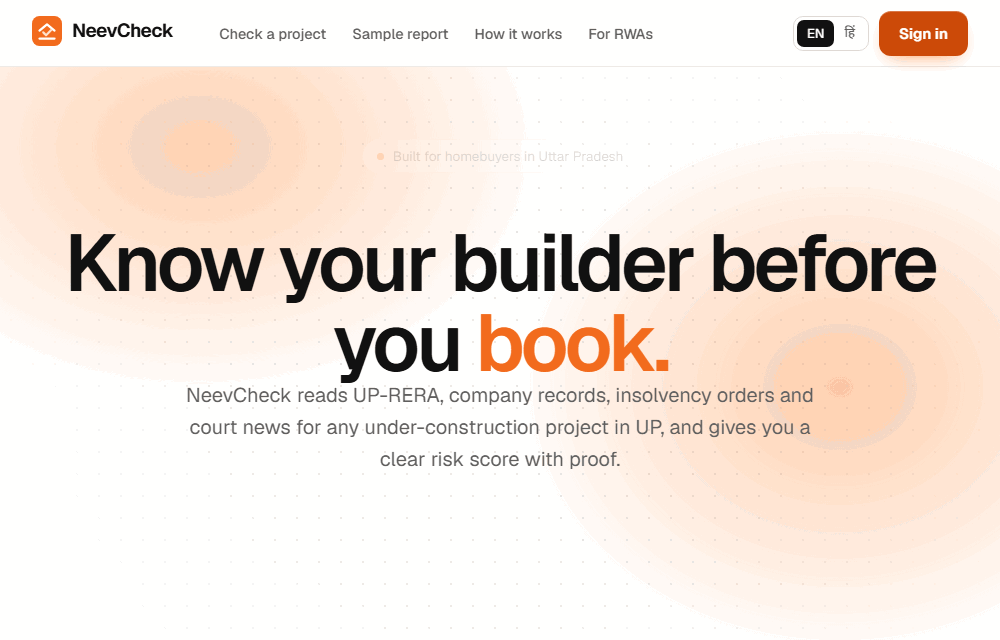
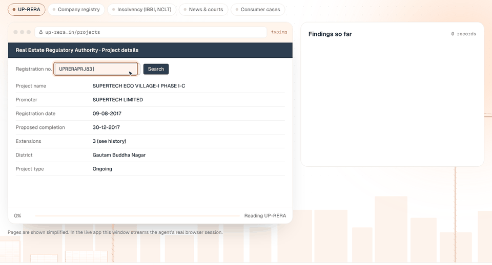
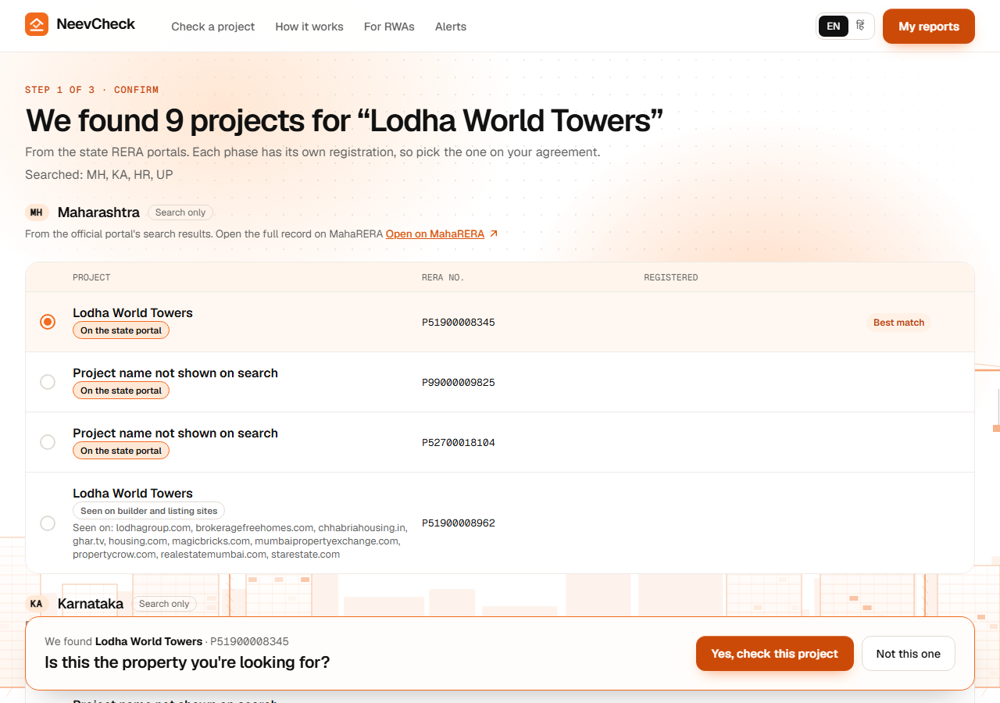
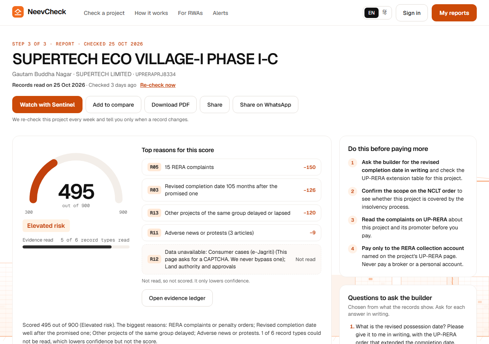
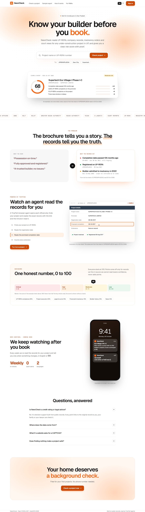
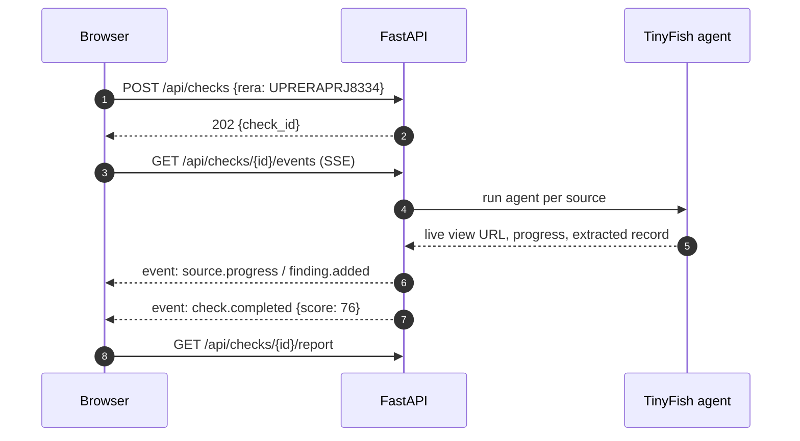

<div align="center">


# NeevCheck

### Know your builder before you book.

A risk check for under-construction homes in Uttar Pradesh. NeevCheck sends **TinyFish browser agents** to read UP-RERA, company, insolvency and court records live, then turns them into one clear **NeevScore** with proof for every point.

[](#roadmap)
[](#team)
[](https://tinyfish.ai)
[](https://nextjs.org)
[](https://fastapi.tiangolo.com)
[](https://www.python.org)
[](LICENSE)

<br>



</div>

---

## Table of contents

- [The problem](#the-problem)
- [What NeevCheck does](#what-neevcheck-does)
- [See it in action](#see-it-in-action)
- [A real check: Supertech Eco Village-I Phase I-C](#a-real-check-supertech-eco-village-i-phase-i-c)
- [How it works](#how-it-works)
- [Architecture](#architecture)
- [NeevScore](#neevscore)
- [Tech stack](#tech-stack)
- [Project structure](#project-structure)
- [Getting started](#getting-started)
- [Roadmap](#roadmap)
- [Responsible use of public data](#responsible-use-of-public-data)
- [Team](#team)

---

## The problem

Buying an under-construction flat is often a family's biggest cheque. The facts that decide whether it will be delivered are public, but they are scattered across government portals that few buyers know about, let alone read.

| | |
| --- | --- |
| **51,000** | homes Supertech booked for delivery in 2010–12, many still waiting ([Supreme Court, Feb 2026](https://www.livelaw.in/top-stories/supreme-court-upholds-nclat-order-directing-nbcc-to-complete-stalled-supertech-housing-projects-522030)) |
| **49,748** | homes in 16 stalled Supertech projects handed to NBCC to finish ([NCLAT order, Dec 2024](https://psuwatch.com/newsupdates/nbcc-appointed-as-consultant-to-complete-supertechs-16-housing-projects)) |
| **5 portals** | a buyer would need to search by hand: UP-RERA, MCA, IBBI / NCLT, land authorities, courts |

A broker's brochure says *"possession on time"*. The records may say the completion date was extended three times. NeevCheck reads the records so the buyer doesn't have to.

## What NeevCheck does

| | Feature | What the buyer gets |
| :-: | --- | --- |
| 🔎 | **Search first, no forms** | Type a project name or UP-RERA number. We show the matching phases and ask *"Is this the property you're looking for?"* before any agent runs. |
| 🤖 | **Agent Cam** | Watch TinyFish browser agents open each official site, find the project and copy the exact record, live. |
| 📊 | **NeevScore (0–100)** | One explained number. Every point lost links to the record behind it. |
| 🗂️ | **Evidence Locker** | Every finding carries its source link and the minute it was read. *No source, no claim.* |
| 🧬 | **Builder DNA** | Sister projects, insolvency scope and linked companies for the same promoter. |
| ✅ | **Buyer Action Plan** | Four concrete things to check before paying more. |
| 🔔 | **Neev Sentinel** | Weekly re-checks; an alert only when a record actually changes. |
| 🌐 | **English and हिंदी** | Plain-language reports for every family member. |

## See it in action

<div align="center">

<br><sub><b>Agent Cam</b> — the agent reads UP-RERA, the company registry, insolvency orders and court news, then stops honestly at a CAPTCHA.</sub>
</div>

<br>

<table>
<tr>
<td width="50%"><br><sub><b>Confirm</b> — real phases from the UP-RERA register. Nothing runs until the buyer confirms.</sub></td>
<td width="50%"><br><sub><b>Report</b> — score, reasons, evidence, timeline and next steps.</sub></td>
</tr>
</table>

<details>
<summary><b>Full home page</b></summary>
<br>

</details>

> Screens are from the approved final design (v1.0). They are refreshed from the running app at each release.

## A real check: Supertech Eco Village-I Phase I-C

A live check of `UPRERAPRJ8334`, read on 25 Oct 2026. Every value comes from a public record; each row links to where it was read. The check is recorded in [`backend/tests/fixtures/check_8334.json`](backend/tests/fixtures/check_8334.json) and replayed by the tests.

| Record | Value | Source |
| --- | --- | --- |
| UP-RERA registration | `UPRERAPRJ8334`, registered 09 Aug 2017 | [UP-RERA](https://www.up-rera.in/Frm_View_Project_Details.aspx?id=8334) |
| Completion date on record | 30 Dec 2017, 105 months ago; project still listed as Ongoing; no extension orders on the register | UP-RERA project page |
| Promoter | SUPERTECH LIMITED · 2,803 complaints on UP-RERA across its projects, 15 about this project | UP-RERA project summary |
| Company status | Active, CIN U74899DL1995PLC074422 | [Economic Times company page](https://economictimes.indiatimes.com/company/supertech-limited/U74899DL1995PLC074422) |
| Insolvency | NCLT admitted an application on 25 Mar 2022. A news report says the order covers the whole company; no court order was read, so this is **not scored** and needs checking against the NCLT and NCLAT orders | [Fortune India](https://www.fortuneindia.com/enterprise/nclt-declares-supertech-insolvent-whats-the-future-of-25000-homebuyers/107553) |
| Completion order | Supreme Court order of 5 Feb 2026 names Eco Village-1 among the 16 stalled Supertech projects the NBCC is to complete | [Supreme Court](https://api.sci.gov.in/supremecourt/2025/5007/5007_2025_1_18_68404_Order_05-Feb-2026.pdf) |
| Consumer cases | 1 case against SUPERTECH LIMITED on the first page of results (NCDRC) | [e-Jagriti](https://e-jagriti.gov.in/advance-case-search) |
| Land authority dues | Not read: the authorities' dues lists could not be fetched | |

**NeevScore 68 / 100 · Moderate risk**

```text
100  starting score
-14  completion date passed 105 months ago; still Ongoing   (UP-RERA)
 -9  2,803 complaints on UP-RERA against the promoter       (UP-RERA)
 -6  15 complaints on UP-RERA about this project            (UP-RERA)
 -3  three news stories on delays                           (secondary)
 ──
 68  Moderate · confidence 86% (6 of 7 key checks) · no hard stop
```

**What the buyer should do next:** read the NCLT and NCLAT orders on the insolvency, ask the builder for the current possession date in writing, check whether this phase is on NBCC's list of 16 projects, and ask the Greater Noida authority for the project's dues position.

## How it works

<div align="center">

</div>

1. **Search.** The buyer types a name or RERA number.
2. **Confirm.** We list matching phases from UP-RERA; the buyer picks the one on their agreement.
3. **Read.** Five TinyFish browser agents read the official sources in parallel and stream their progress to the Agent Cam.
4. **Evidence.** Each record is stored with its URL, the time it was read and how reliable the source is.
5. **Score.** A deterministic formula turns findings into the NeevScore. Same records, same score.
6. **Report.** Score, reasons, evidence, timeline and a buyer action plan, in English or Hindi.
7. **Sentinel.** A weekly re-check alerts the buyer only when something changes.

## Architecture




More detail in [`docs/architecture.md`](docs/architecture.md).

## NeevScore

Every project starts at **100**. Points come off only for records we find, weighted by area. Absence of a record never adds points; a source we cannot read lowers **confidence**, not the score.

| Area | Weight | Examples |
| --- | --: | --- |
| UP-RERA compliance | 25% | registration status, missed quarterly updates |
| Project execution | 20% | completion date extensions, delay length |
| Legal and courts | 15% | orders against the promoter |
| Financial and insolvency | 15% | insolvency of the company or this project |
| Builder history | 15% | stalled sister projects |
| News | 10% | delay or fraud coverage (secondary) |

| Band | Range |
| --- | --- |
| 🟢 Low | 80–100 |
| 🟡 Moderate | 60–79 |
| 🟠 High | 40–59 |
| 🔴 Critical | 0–39 · any hard stop (for example, this project in insolvency) caps the score here |
| ⚪ Not enough evidence yet | shown instead of a band while fewer than half the key checks are read; the score is provisional |

Full method and test cases: [`docs/scoring.md`](docs/scoring.md).

## Tech stack

| Layer | Choice | Why |
| --- | --- | --- |
| Browser agents | **TinyFish Web Agent API** | Reads real government portals like a person, with a live view we can show buyers |
| Frontend | **Next.js 15**, React 19, TypeScript | Server rendering for fast first load, simple file-based routes |
| Styling | Plain CSS with design tokens, CSS animations | Easy to read; no runtime animation library needed |
| Fonts | Geist, Geist Mono, Noto Sans Devanagari | Clean UI type with proper Hindi support |
| Backend | **Python 3.12, FastAPI**, Pydantic | Typed API, async streaming with Server-Sent Events |
| Storage | SQLite (local), Postgres (production) via SQLAlchemy | Zero setup locally, one switch to deploy |
| Quality | pytest, Ruff, ESLint, TypeScript strict, Playwright | Every change linted, typed and tested |
| CI / security | GitHub Actions, gitleaks, Dependabot | Tests on every push, secret scan over full history |
| Hosting | Vercel (frontend), Render (backend) | Free tiers that fit a hackathon demo |

## Project structure

```text
.
├── backend/                 FastAPI service
│   ├── app/
│   │   ├── api/             routes: search, checks, events (SSE), reports
│   │   ├── sources/         one module per public source, plus the shared agent runner
│   │   ├── parsers/         deterministic page parsers (UP-RERA)
│   │   ├── scoring/         NeevScore engine and weights
│   │   ├── orchestrator.py  runs a check and streams its events
│   │   ├── tinyfish.py      the only module that calls TinyFish
│   │   ├── models.py        Pydantic models shared by the API
│   │   └── main.py
│   ├── scripts/             capture_fixtures.py records real responses for tests
│   └── tests/               pytest, with recorded TinyFish responses in fixtures/
├── frontend/                Next.js app (home page so far)
│   └── src/
│       ├── app/             routes: home, check/[id], report/[id]
│       ├── components/      Skyline, AgentCam, ScoreRing, EvidenceList …
│       └── styles/          tokens.css and globals.css
├── docs/                    architecture, scoring, data sources, assets
└── .github/                 CI, issue forms, pull request template
```

## Getting started

> The app is being rebuilt in phases on the final design. The backend runs live checks from **v0.2** (end of Phase 2); the frontend has its home page from Phase 3, and the check flow follows in Phase 4. Every check is live, so you need a [TinyFish API key](https://agent.tinyfish.ai/api-keys).

```bash
git clone https://github.com/Nitinmittal373/HACKATHON_IIIT-DELHI_2026.git neevcheck
cd neevcheck
cp .env.example .env            # then set TINYFISH_API_KEY in .env

# backend
cd backend
python -m venv .venv && source .venv/bin/activate
pip install -r requirements-dev.txt
uvicorn app.main:app --reload    # http://localhost:8000/docs
ruff check . && pytest -q        # tests replay recorded responses, no key needed

# frontend (new terminal)
cd frontend
npm install
npm run dev                      # http://localhost:3000
```

The key never leaves your machine: `.env` is git-ignored and the app never logs it. A `TINYFISH_API_KEY` set in your shell takes precedence over `.env`.

Try a check from the terminal once the backend is running:

```bash
curl "localhost:8000/api/projects/search?q=UPRERAPRJ8334"
curl -X POST localhost:8000/api/checks -H "Content-Type: application/json"      -d '{"rera_id": "UPRERAPRJ8334"}'                       # returns {"id": ...}
curl -N localhost:8000/api/checks/<id>/events               # live event stream
curl localhost:8000/api/checks/<id>/report
```

The full API is described in [`docs/architecture.md`](docs/architecture.md#api).

## Roadmap

- [x] **Phase 0 · Foundation** — repo structure, CI, security policy, contribution guide, final design approved
- [x] **Phase 1 · Backend core** — API, data models, NeevScore engine, live UP-RERA source, event stream, shared agent runner
- [x] **Phase 2 · TinyFish agents** — five source agents, live view streaming, CAPTCHA handling
- [x] **Phase 3 · Frontend foundation** — design tokens, layout, animated skyline, home page
- [ ] **Phase 4 · Check flow** — search, confirm, Agent Cam, report
- [ ] **Phase 5 · Sentinel and sharing** — weekly re-checks, alerts, PDF, Hindi
- [ ] **Phase 6 · Launch** — accessibility, end-to-end tests, deployment, v1.0

## Responsible use of public data

- **Public records only.** NeevCheck reads official portals and published reports. No private data is collected.
- **No CAPTCHA bypassing, ever.** If a site asks for one, the source is marked *Unable to verify*.
- **No source, no claim.** Every finding links to where it came from and when it was read.
- **Decision support, not advice.** NeevCheck is not a credit rating or legal advice. Verify important facts on the official portal.
- **Your keys stay yours.** API keys live only in a local `.env`. See [`SECURITY.md`](SECURITY.md).

## Team

Built by **Team RYZEN** from KIET Group of Institutions for the HackIIITD 2026 finale at IIIT Delhi.

<table>
<tr>
<td align="center" width="180"><a href="https://github.com/rishibhaskar777"><br><b>Rishi Bhaskar</b></a><br><sub>Product, frontend and design</sub></td>
<td align="center" width="180"><a href="https://github.com/Nitinmittal373"><br><b>Nitin Mittal</b></a><br><sub>Backend, TinyFish agents and data</sub></td>
</tr>
</table>

Want to help? Read [`CONTRIBUTING.md`](CONTRIBUTING.md).

## License

[MIT](LICENSE) © 2026 Rishi Bhaskar and Nitin Mittal

<div align="center"><sub>Built on public records, read by TinyFish agents.</sub></div>
