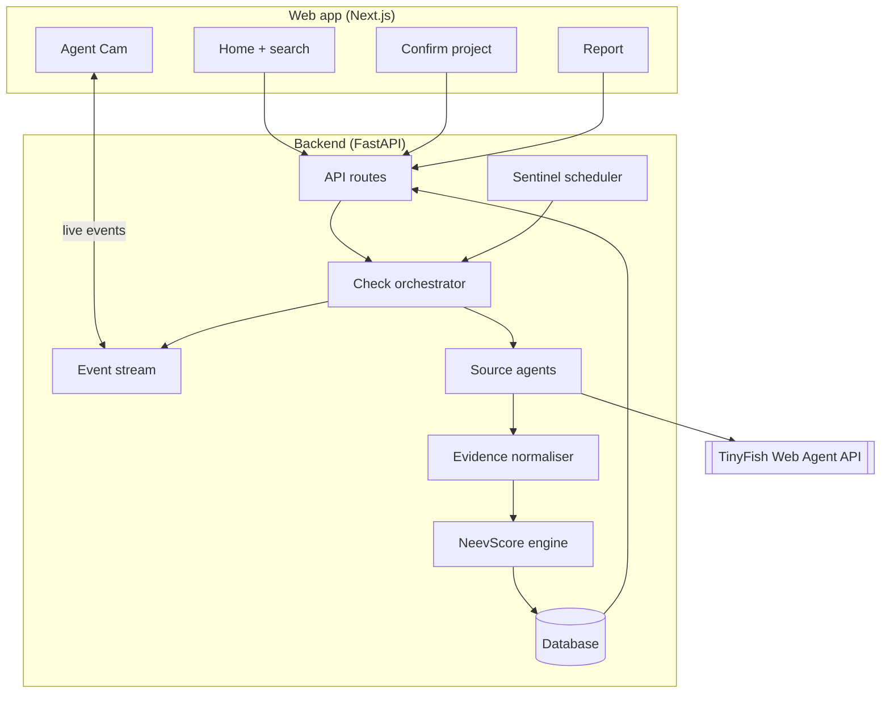
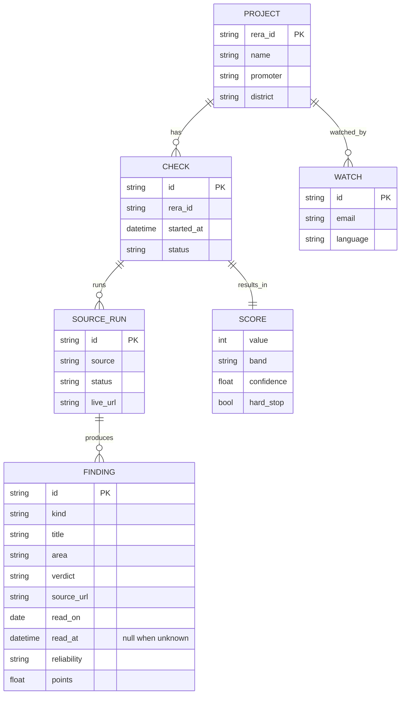
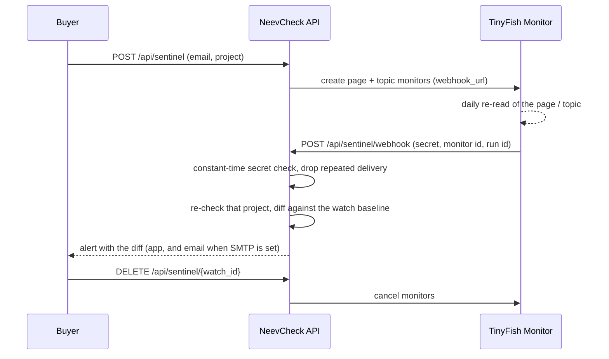
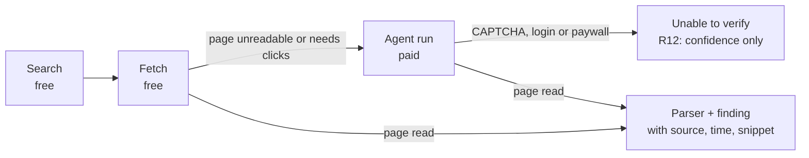

# Architecture

NeevCheck has two parts: a **Next.js** web app that buyers use, and a **FastAPI** service that runs TinyFish browser agents, stores evidence and calculates the NeevScore.



## Request flow

| Step | Endpoint | What happens |
| --- | --- | --- |
| 1. Search (from the browser) | `GET /api/projects/search?q=` | A RERA number is confirmed on its own UP-RERA page; a name or promoter goes through TinyFish Search limited to up-rera.in (see [Finding a project](#finding-a-project)) |
| 2. Confirm | `POST /api/checks` | Creates a check for one registration number and starts it; returns the check and its `id` (202) |
| 3. Watch | `GET /api/checks/{id}/events` | Server-Sent Events: `source.started`, `source.live_url`, `source.progress`, `finding.added`, `source.blocked`, `source.completed`, `check.completed` |
| 4. Report | `GET /api/checks/{id}/report` | Score, drivers, evidence and timeline (action plan in Phase 4) |
| 5. Watch list | `POST /api/sentinel` | Adds the project to weekly re-checks; alerts are read with `GET /api/sentinel/alerts?email=` |

## State adapters

`backend/app/states/` holds one small file per state. Each builds a `StateAdapter` from the facts in [states.md](states.md): code, name, authority, domains, number patterns, coverage level, examples and complaint page.

```
buyer's text ─► detect_state ─► registry ─► StateAdapter ─┬─ resolve(query)  Search on the state's domains
   (any state)   (number format)                          ├─ read(project)   ProjectRecord (state-agnostic)
                                                          └─ details_url / complaint_url / coverage
UP:   UpAdapter wraps the original UP-RERA code (Fetch + parser), unchanged
rest: SearchStateAdapter reads the portal's own pages through Search snippets (and the page or
      list row when Fetch can open it: Goa, Bihar, Jharkhand)
```

`ProjectRecord` (state, number, name, promoter, district, registration date, promised and revised completion, extensions, status, complaints, `source_url`, `read_at`, the snippet text) is all the scoring needs. `StateReraSource` turns it into the same findings UP-RERA gives, so NeevScore v2 is unchanged for every state; a fact the portal did not show stays unread (R12) and never costs points. The findings of a search-only read carry `via: "search_snippet"`. The state is not stored: every number format belongs to exactly one state, so `state_of(rera_id)` gives it back, and records made before all-India support are UP.

`GET /api/states` lists the adapters; `GET /api/projects/search?q=&state=` accepts an optional state. With no state, a number is routed by its format and a name is searched with one combined Search across every portal, then one focused Search for the three states that answered best, plus UP. `POST /api/checks` takes an optional `state`; the details link is accepted only on that state's own domains. The source cache is keyed by state for every state but UP.

## Finding a project

For UP, `app/resolve.py` (behind `UpAdapter`) turns what the buyer typed into at most 8 candidates, each with its name, promoter, district and registration date, and the page a check will read.

| Typed | How it is found |
| --- | --- |
| A number from 2017-18, `UPRERAPRJ8334` | Its stable details page is read directly; no Search |
| A later number, `UPRERAPRJ188811/08/2024` or six digits such as `UPRERAPRJ396176` | These have no stable page, so Search for the exact number on up-rera.in finds its Projectsummary page |
| A project or promoter name | TinyFish Search limited to up-rera.in. If no result carries a number, a second Search without the limit is read for UPRERAPRJ numbers |
| `uprera prj 8334`, `UPRERA-PRJ-8334` | Spaces, hyphens, dots and case are normalised first |

A number counts only when its own up-rera.in page shows it with a name and a promoter. Numbers from the second, unlimited Search must also share a word with the query, because pages about one project often print the numbers of others. Search results are completed from their own pages, four at a time within 35 seconds; a page that cannot be read in time keeps what Search said, since that came from up-rera.in itself. A query with no UP-RERA project (a project outside Uttar Pradesh, for example) returns an empty list, which the app shows as "No UP-RERA project found" with tips.

### Finding a project on the open web

A state portal Search cannot read still has its projects' numbers printed by the builder and by listing sites, so `app/states/openweb.py` also runs two Searches with no domain limit (`<q> RERA registration number`, `<q> RERA`, cached for 24 hours) beside the portal search. It looks for the number formats of every state (`id_patterns`) in the titles and snippets and votes:

| Who prints the number | Points |
| --- | --- |
| A page on that state's RERA domain | +3 |
| The builder's own site (its domain holds the brand word of the query) | +2 |
| Any other distinct domain | +1 each |

A number is kept at 3 points, or when two domains print it, and only if one of them prints it next to the project's name (at least 75% of its distinctive words, city names ignored). A list of projects gives each number only the words up to its neighbours, so a number beside another project's name is not this project's. Plain formats such as `112 of 2021` need "RERA" beside them. Several numbers (phases, towers) are separate candidates.

Each kept number is then searched exactly on its state's domain (`app/states/confirm.py`, at most four per query). A page that prints it makes the candidate `confirmed`; otherwise it stays `listings_only` and the app says so. Listing sites are used only to find the number; a finding still needs the portal. A listing sentence such as "does not apply to RERA and has already been delivered" (`app/states/prerera.py`) becomes a `pre_rera` note: the app quotes the sentence, links the page and offers a builder-only check, with no project score. A number typed alone that no portal page names gets its builder from `identify_builder`.

### Builder and locality search

For buyers whose project has no website to search:

- `GET /api/promoters/search?q=&state=&city=` (`app/states/promoter_search.py`) takes a builder's name and runs three Searches: the state RERA domains (the named state, the state of the named city, or all of them), company-registry mirrors of MCA data (name and CIN only), and the open web, whose numbers are voted on like a project name's. It returns the registered projects found, each with its number, state, status and the sites that printed it, and the company pages found. Generic words such as "Limited" and "Developers" never decide a match, and different Lodha companies are listed apart, never merged.
- `GET /api/projects/search?q=&locality=` adds a city or locality ("Sector 150 Noida"). `app/states/places.py` maps about 150 cities and areas to a state, so the portals searched narrow to it; the locality is added to the open-web search and never counts as part of the project's name.

### Brochure, agreement and QR

`POST /api/extract` finds the number in a document the buyer already has. It takes a PDF as the raw request body (`Content-Type: application/pdf`, at most 5 MB, 40 pages read) or `{"text": "..."}` for the address a QR code held; at most ten requests a minute per address. The PDF is read in memory with pypdf and never written to disk, so there is nothing to delete afterwards; only the numbers and the words around each one come back, with phone numbers, e-mail addresses, PAN and Aadhaar numbers replaced by `[removed]`. The numbers are searched on their state's portal like any other (`from_document` until a portal page prints them, then `confirmed`). A photo is never uploaded: the browser decodes its QR code (jsQR) and sends only the text, and no OCR runs anywhere.

### Public orders

Only when the portals, the open web and the buyer's documents found nothing, `app/states/orders.py` searches for orders that name the project (`<q> RERA order`, `<q> judgment` on indiankanoon.org, `<q> NCLT order` on nclt.gov.in). An order published as a PDF (a court, tribunal or government site) is opened with Fetch, up to two a query, and read for a registration number next to the project's name; those numbers are `from_order` candidates with the order's link in `found_in`. Fetch cannot read every court site, so a page it fails to read falls back to its snippet and no number is invented. When an order only names the builder ("X vs Mahagun India Pvt. Ltd."), the search answers with an `order_leads` entry (builder, order title and link) and the app offers that builder's registered projects. Orders are only a way to find the project; they are never a finding in a report.

## Sources

Each source is one small module with the same shape: it reads one kind of public record and yields events (progress, live view URL, findings, which key checks it read). It never writes to the database; the orchestrator does.

| Source | Site | How it reads | Extracts |
| --- | --- | --- | --- |
| `uprera` | up-rera.in | **Fetch** + deterministic Python parser; the summary page is found with Search | name, number, registration date, promoter, type, district, start and end dates, extensions granted, completion certificate date, permits, documents, complaint counts |
| `registry` | MCA, Economic Times, zaubacorp | Search finds the page; **Fetch** + parser reads the details table, an **agent** reads it when Fetch cannot | company name, CIN and status |
| `insolvency` | NCLT / NCLAT orders and reports, IBBI | Search finds a page about the promoter's case; an **agent** reads it | whether the case was admitted, when, and which projects it covers |
| `land` | Noida, Greater Noida and Yamuna Expressway authorities | Search + **Fetch** of the published dues list (usually a PDF), searched in Python | whether the promoter is on a dues list |
| `consumer` | e-Jagriti | an **agent** opens the case search and stops at its CAPTCHA | cases against the promoter, only if the portal shows results without one |
| `news` | news sites, Supreme Court | Search (news) and Fetch of a court order | up to three delay stories, and whether the NBCC order names the project |

UP-RERA runs first: it confirms the project exists and names the promoter the other sources look for. If it cannot be read, the check fails and no score is shown. The other sources run in parallel, at most `AGENT_CONCURRENCY` at a time, each within `AGENT_TIMEOUT_SECONDS`.

### Fetch or agent?

Fetch and Search are cheap, fast and repeatable, so a page that Fetch can turn into text is read in Python. An agent (a real browser driven by a goal in plain English) is only used where a person would have to click: a search form, a page that renders in the browser, an article whose scope has to be read. Each agent source is a module with a `GOAL`, an `OUTPUT_SCHEMA` and a pure `to_findings()` that turns the agent's JSON into findings. Python, not the agent, decides what the facts mean: for example, whether an insolvency covers this project is decided by matching project names word for word, so Eco Village-I is never matched to Eco Village-II.

### Live view and progress

Agent sources share one runner (`app/sources/agent.py`). It maps the agent's stream onto the event stream the Agent Cam reads:

| TinyFish event | NeevCheck event |
| --- | --- |
| started | `source.started` (sent by the orchestrator when the source begins) |
| streaming URL | `source.live_url`, the address of the live browser view |
| progress | `source.progress`, the agent's note cut to one line of at most 140 characters |
| complete | `finding.added` for each finding, then `source.completed` |

The runner tells every agent never to solve or get around a CAPTCHA, and marks the source `blocked` when one appears. It does not trust the agent's own `captcha_seen` flag alone: a progress note that mentions a CAPTCHA also stops the run and blocks the source, because a recorded e-Jagriti run once reported no CAPTCHA while its notes showed it typing one. A run that fails or returns only empty fields leaves the source **unread**, which lowers confidence and never changes the score. A run that runs out of time is `blocked` with the reason `timeout` and is not retried. Agents are opened on deep pages, never on a large homepage, and every run is capped by `AGENT_TIMEOUT_SECONDS`. The raw answer of each agent is saved under `backend/data/cache/{check_id}/{source}.json` (git-ignored) so a surprising finding can be traced back to what the agent returned.

At most `AGENT_CONCURRENCY` (2) agents run at once. TinyFish accepts a step limit only on beta accounts; set `AGENT_SEND_MAX_STEPS=true` once yours is enabled.

## Testing without the network

Tests never call TinyFish. `scripts/capture_fixtures.py` records real responses (UP-RERA pages, search results) into `backend/tests/fixtures/` through the same client and selectors the app uses, and refuses to save a file that contains the API key. `python -m scripts.capture_fixtures check_8334.json` runs one complete live check of `UPRERAPRJ8334` and records every search, document and agent answer, scrubbed of emails, phone numbers and live-view addresses. Tests replay them through a fake `WebClient`, with the clock fixed to the day of the recording, so the score is stable. One optional test, `pytest -m live`, runs a real check when `TINYFISH_API_KEY` is set; it is deselected by default and skipped in CI.

## API

Interactive docs are served at `/docs`.

| Method and path | Success | Errors |
| --- | --- | --- |
| `GET /api/health` | `200 {"status": "ok"}` | |
| `GET /api/meta` | `200 {scale, bands[], pillars[], reason_codes[], score_version}`: the NeevScore scale (300 to 900), band edges, pillar weights and reason codes, read from the scoring constants | |
| `GET /api/projects/search?q=` | `200 {query, candidates[]}`, at most 8; answers within 90 seconds | `422` query shorter than 2 characters; `502` TinyFish failed, `504` too slow, `429` TinyFish rate limit (with `Retry-After`). Each error's `detail.code` names the reason: `tinyfish_key`, `wallet_empty`, `rate_limited`, `timeout`, `unreachable` or `upstream` |
| `GET /api/promoters/projects?name=&exclude=` | `200 {promoter, projects[], searched_at}`: up to 10 other UP-RERA projects whose up-rera.in search results carry the promoter's full legal name, each with its `display_score` when NeevCheck already holds a finished check of it; Search only, cached per promoter for 24 hours | `422` name shorter than 3 characters; `502` with `detail.code` when TinyFish fails |
| `POST /api/checks` `{rera_id, details_url?, fresh?}` | `202` check, `Location` header; `200` with `reused: true` when a check of the same project finished in the last 24 hours (send `fresh: true` to re-check) | `422` bad input, `429` over `RATE_LIMIT_PER_MINUTE` or over `MAX_CHECKS_PER_DAY` (`detail.code` is `daily_cap`; both send `Retry-After`) |
| `GET /api/checks?ids=a,b,c` | `200` a summary of each known check (`id`, `rera_id`, `details_url`, `project`, `promoter`, `status`, `display_score`, `created_at`, `completed_at`, plus the classic `score`, `band` and `confidence`), in the order asked; ids the server does not have are left out | `422` more than 50 ids or a malformed one |
| `GET /api/checks/recent` | `200` the latest finished check of up to 12 projects, newest first, each with its `display_score`, top three reasons, registration date and sources read. No emails or IP addresses | |
| `GET /api/checks/compare?ids=a,b,c` | `200` two or three finished checks side by side: `display_score`, points lost per pillar, months past the completion date, complaint counts, insolvency, company status, unread checks and top three findings with links (`null` where a check could not read something), plus `best` and `reason` (`best_score`, `tie`, `not_enough_evidence`) | `422` not two or three valid ids, `404` unknown check, `409` a check with no score |
| `GET /api/checks/{id}` | `200` check with each source's status and, once it has one, its `display_score` | `404`, `422` malformed id |
| `GET /api/checks/{id}/events` | `200 text/event-stream` | `404` |
| `GET /api/checks/{id}/report` | `200` `display_score`, `score_v2` (pillars, reason codes, drivers), the classic `score`, findings, timeline | `404`, `409` still running or failed |
| `POST /api/sentinel` `{rera_id, details_url?, email, language}` | `201` watch (`200` if the same email already watches it) | `422` bad input, `409` more than 3 watches for one email, `429` rate limit |
| `GET /api/sentinel/alerts?email=` | `200` alerts, newest first, each with `old_display_score` and `new_display_score` | `422` bad email |
| `POST /api/sentinel/run` with header `X-Webhook-Secret` | `202` `{started}`; starts a re-check run for an external cron | `401` missing or wrong secret (always, when `WEBHOOK_SECRET` is not set) |
| `POST /api/sentinel/webhook` with header `X-Webhook-Secret` or `?secret=` | `202` `{status}`: `accepted` (the project is re-checked in the background), `duplicate` (a delivery already handled) or `ignored` (a monitor we do not know). Called by TinyFish monitors | `401` missing or wrong secret, `413` payload over 200 kB |
| `DELETE /api/sentinel/{watch_id}` | `204`; removes the watch and cancels its TinyFish monitors | `404` unknown watch |
| `POST /api/corrections` `{report_id, finding_id?, message, contact?}` | `201` `{id}`; stored for the operator | `404` unknown report, `422` bad input, `429` rate limit |
| `GET /api/corrections` with header `X-Webhook-Secret` | `200` the latest corrections, newest first (admin log) | `401` missing or wrong secret |

`rera_id` accepts `UPRERAPRJ8334` and new-format numbers such as `UPRERAPRJ188811/08/2024` (case, spaces, hyphens and dots are ignored). Send the `details_url` that search returned; it must be an `https` link on up-rera.in. It is required for new-format numbers, and a number sent without one gets its stable details page, which only numbers registered in 2017-18 have.

### The score in every answer

The backend owns the scale. Every answer that shows a score carries `display_score`, the NeevScore v2 summary (300 to 900), and the frontend draws nothing else; the classic 0–100 `score` fields are kept for older clients and for one line in the report's method section. A check stored before NeevScore existed has no stored v2 result, so the store re-scores it from its findings and source runs when it is read (same engine, nothing written back), and no screen falls back to the old number.

### Events

Every event is sent as `event: <type>` with JSON `data` holding `type`, `check_id`, `source`, `ts` and a `data` object. A browser that connects late receives the whole run from the start. A comment line is sent every 15 seconds while nothing happens.

| Event | `data` |
| --- | --- |
| `source.started` | |
| `source.live_url` | `url` of the live browser view |
| `source.progress` | `text` |
| `finding.added` | `finding` (with `source_url`, `read_on`, `read_at`) |
| `source.blocked` | `reason` (for example a CAPTCHA) |
| `source.completed` | `status` (`completed`, `blocked`, `failed`, `unavailable`), `message`, `checks_read` |
| `check.completed` | `status` (`completed` or `failed`), `display_score` (`value`, `band`, `hard_stop`, `confidence`, `provisional`), the classic `score` summary, or `message`; `source` is `check` |

### API contract

The API's shape is written down once and checked everywhere:

1. Every route returns a Pydantic model, and every response model derives from `ApiModel`, which marks defaulted fields as required in the schema because an answer always carries them. The server-sent events have one model per type (`app/stream_events.py`, published under `StreamEvent`).
2. `backend/scripts/export_openapi.py` writes [`contracts/openapi.json`](../contracts/openapi.json) from the app, with sorted keys, no server and no network. It also writes `frontend/src/lib/meta.fallback.ts`, what `GET /api/meta` answers, for when the API cannot be reached.
3. `npm run gen:api` turns the contract into `frontend/src/lib/api-schema.d.ts` with `openapi-typescript`. `frontend/src/lib/types.ts` only names those generated types, and `api.ts`, `checkState.ts` and `useCheckEvents.ts` are typed from them, so a backend change that breaks the frontend fails `tsc`.
4. CI regenerates both files and fails with *API contract out of date: run `make contract`* if either differs from what is committed. A backend test also checks that every route is in the contract and that the recorded browser-test answers (`frontend/e2e/fixtures/`) still match the models.

To change the API: edit the backend model, run `make contract` at the repository root, and commit the generated files with the change. The score scale itself is not a type but data: the frontend reads it from `GET /api/meta` on the server (cached for an hour, with the generated fallback) and never writes 300, 900, a band edge or a weight in code; a test enforces it.

## Data model



## Neev Sentinel

A watch is an email, a project and a language (at most three watches per email). A re-check runs every `SENTINEL_INTERVAL_HOURS` (default 168, one week; `0` turns the built-in schedule off) from a loop in the app's lifespan, and `POST /api/sentinel/run` starts the same run for an external cron; the secret is compared in constant time.

Each re-check is a normal check. It is compared with the check the watch last saw, and **only real changes create an alert**:

- A finding is identified by `source + kind` (plus its link for news stories), never by its title, because titles hold numbers such as "passed 105 months ago" that move every month.
- Two findings with the same key but different facts (a count, an insolvency scope, a date, a verdict) are *changed*. A key only in the new check is *added*; only in the old one, *removed*.
- Only sources that both checks read are compared. Unread to unread is never a change; a source that went unreadable does not make its records "removed", and a source read for the first time does not make them "added".
- The first finished check of a project is a baseline, not a change.

An alert stores the old and new NeevScore and the diff, and is shown at `/alerts?email=`. If `SMTP_HOST` and `SMTP_FROM` are set it is also emailed, to the watch's address only; without them it is stored and shown in the app.

### Cost guards

`MAX_CHECKS_PER_DAY` (default 30) caps the checks started per UTC day, Sentinel's included; past it new checks get `429` with the wait until midnight and Sentinel stops its run. A check of the same project that finished in the last 24 hours is returned instead of starting another (`reused: true`); the report then says "Checked X h ago" with a **Re-check now** button that sends `fresh: true`.

### Watching with TinyFish Monitors

When `PUBLIC_BASE_URL` and `WEBHOOK_SECRET` are both set, a new watch also creates two TinyFish monitors (a daily schedule, since every completed check is billed):

- a **page monitor** on the UP-RERA details URL: "alert if the completion date changes, a new extension or penalty order appears, or the registration status changes";
- a **topic monitor** for `"<builder>" homebuyers protest OR NCLT`.



The webhook only decides *which project to re-check*; the alert is always built from a normal check and its diff, so a monitor cannot put a claim in a report. The daily check cap still applies. TinyFish is given the secret inside the webhook URL because a monitor can only be given a URL; the endpoint also accepts it as the `X-Webhook-Secret` header. A failed monitor call is logged and never fails the watch. Without `PUBLIC_BASE_URL` nothing changes: the built-in Sentinel schedule is the only trigger. Monitors are billed on the TinyFish wallet ($0.005 per completed check), so one watch costs about $0.01 a day.

## The escalation ladder

Every source tries the cheapest way to read a page first and only escalates when it has to.



A report costs at most three agent runs: the insolvency source and e-Jagriti each use one, and the registry source only when Fetch cannot read its page. UP-RERA, the builder's group, lender notices, land-authority lists and news are read with Search and Fetch alone. Results are cached per (source, entity, day) with `V2_SOURCES=true`.

## Free-plan cold starts

The API runs on Render's free plan, which sleeps after 15 idle minutes and takes about a minute to wake. Search therefore runs in the **browser**, straight to the API, never in a Vercel function (whose time limit a cold start plus a live search can exceed):

1. The home page sends a silent `GET /api/health` on load, so the server starts while the visitor reads.
2. The confirm page waits for that same ping. If it takes longer than 1.5 seconds it says "Waking up the server…", then "Searching UP-RERA…" once the server answers.
3. Search may take up to 120 seconds in the browser. A dropped connection, or a `502`/`503`/`504` from Render's proxy (no `detail.code`), is retried once. Errors from the API itself carry a `detail.code` and are shown as they are, never retried.

## My reports, without accounts

NeevCheck has no sign-in. The app keeps the ids of the checks a visitor starts in `localStorage` (`neevcheck-reports`, newest first, at most 50) and asks `GET /api/checks?ids=` for their state, so the list is private to that browser. Ids the server no longer knows (for example after its database was reset) are dropped from the list with a note. The home page's report card and its "Recently checked" strip come from `GET /api/checks/recent`, fetched in the browser after the page loads; before any check has finished, the card is an empty frame that says "Your report appears here", never sample numbers.

## Compare

`app/compare.py` builds the comparison from each check's report. A value a check could not read is `null`, never zero. "Best on the records" is the highest `display_score.value` among checks whose NeevScore read at least half of the six pillars (the same bar a score needs for a risk band); with fewer than two such checks the answer is "not enough evidence to rank", and equal scores are a tie. The app tints the better value of each row in orange only when every column has a value, and compares the six pillars only when every check is rated, because zero points lost can mean nothing was found or nothing was read. Picks are kept in `localStorage` (`neevcheck-compare`, at most three), shared by My reports and each report's **Add to compare** button.

## Report extras

- **Builder track record**: `app/track_record.py` runs two TinyFish Searches on up-rera.in for the promoter's legal name and keeps only results that carry that full name, so "Supertech Limited" never collects a sister company's projects. Snippets are often cut short, so the list can be incomplete, and the report says so. Each project has a **Check** button that opens its confirm step.
- **Questions to ask the builder**: five questions chosen by rules in `frontend/src/lib/builderQuestions.ts` (a delay asks for the revised possession date in writing, complaints ask what they were about, insolvency asks about the NCLT order's scope, an unread e-Jagriti asks about pending cases; the RERA collection account number is always asked), with a copy-all button.
- **Share on WhatsApp** opens `wa.me` with a short text: project, NeevScore with its scale and band, and the report link.

## Resuming a check

`/check/{id}` loads the check in the browser. A finished check goes straight to its report; a running one opens the Agent Cam, whose event stream replays every event so far and then follows the run, so a refresh or a reopened tab loses nothing. Agents run inside the API process, so a restart or redeploy ends them: on startup the API marks any check still queued or running as failed, instead of leaving it "running" forever. Each report shows "Records read on <date>"; after seven days it says the records are more than a week old and puts **Re-check now** first.

## Source cache (v2)

With `V2_SOURCES=true` each source result is kept per (source, entity, day) in the `source_cache` table. Registry, insolvency, land, news and lender notices are reused for the same UTC day, the group source for 7 days. A reused read keeps the time it was really read, and "Re-check now" bypasses the cache. Blocked or failed reads are never kept. `python -m scripts.prewarm UPRERAPRJ8334 ...` runs real checks ahead of a demo.
