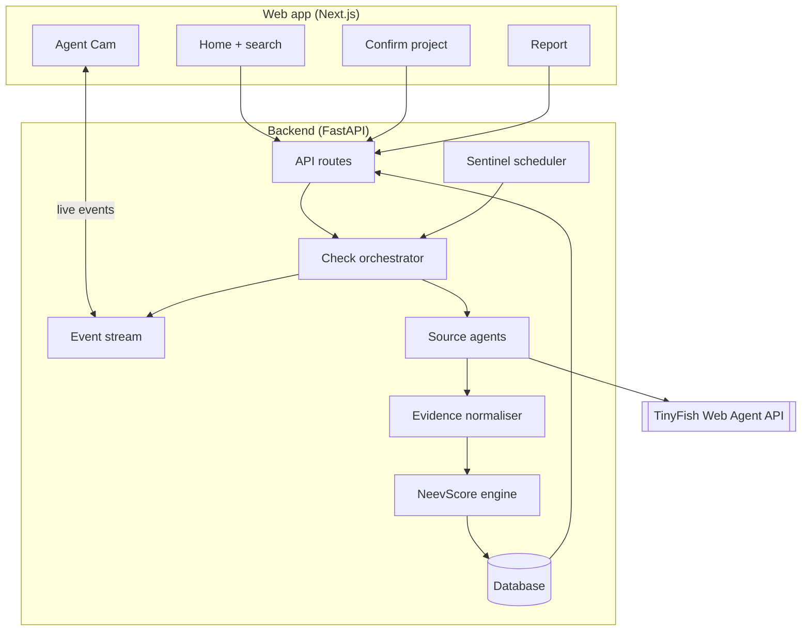
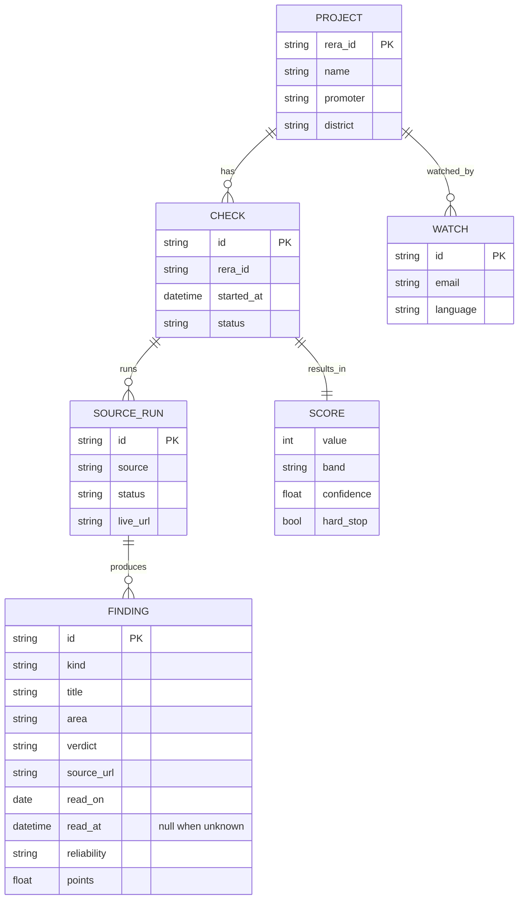

# Architecture

NeevCheck has two parts: a **Next.js** web app that buyers use, and a **FastAPI** service that runs TinyFish browser agents, stores evidence and calculates the NeevScore.

## Request flow

| Step | Endpoint | What happens |
| --- | --- | --- |
| 1. Search | `GET /api/projects/search?q=` | A RERA number opens its UP-RERA page; a name or promoter goes through TinyFish Search (up-rera.in results only) |
| 2. Confirm | `POST /api/checks` | Creates a check for one registration number and starts it; returns the check and its `id` (202) |
| 3. Watch | `GET /api/checks/{id}/events` | Server-Sent Events: `source.started`, `source.live_url`, `source.progress`, `finding.added`, `source.blocked`, `source.completed`, `check.completed` |
| 4. Report | `GET /api/checks/{id}/report` | Score, drivers, evidence and timeline (action plan in Phase 4) |
| 5. Watch list | `POST /api/sentinel` | Adds the project to weekly re-checks *(Phase 5)* |

## Sources

Each source is one small module with the same shape: it reads one kind of public record and yields events (progress, live view URL, findings, which key checks it read). It never writes to the database; the orchestrator does.

| Source | Site | How it reads | Extracts |
| --- | --- | --- | --- |
| `uprera` | up-rera.in | TinyFish **Fetch** + deterministic Python parser; the summary page is found with Search | name, number, registration date, promoter, type, district, start and end dates, permits, documents, complaint counts |
| `registry` | zaubacorp.com / mca.gov.in | TinyFish agent *(Phase 2)* | company status, CIN |
| `insolvency` | NCLT / NCLAT orders, IBBI | Search + agent *(Phase 2)* | admitted cases and which projects they cover |
| `land` | Noida, Greater Noida, YEIDA | agent *(Phase 2)* | dues or defaulter entries |
| `consumer` | e-Jagriti | agent *(Phase 2)*, usually stops at a CAPTCHA | cases against the promoter |
| `news` | news sites | Search (news) *(Phase 2)* | up to three delay stories, secondary |

UP-RERA runs first: it confirms the project exists and names the promoter the other sources look for. If it cannot be read, the check fails and no score is shown. The other sources run in parallel, at most `AGENT_CONCURRENCY` at a time, each within `AGENT_TIMEOUT_SECONDS`.

Agent sources share one runner (`app/sources/agent.py`). It streams the live browser URL to the Agent Cam, tells every agent never to solve or get around a CAPTCHA, and marks the source `blocked` when one appears. A run that fails, times out or returns only empty fields leaves the source **unread**, which lowers confidence and never changes the score. Agents are opened on deep pages, never on a large homepage.

UP-RERA pages are fetched with CSS selectors for only the sections the parser uses, so bank details and phone numbers on the page are never stored.

## Testing without the network

Tests never call TinyFish. `scripts/capture_fixtures.py` records real responses (UP-RERA pages, search results) into `backend/tests/fixtures/` through the same client and selectors the app uses, and refuses to save a file that contains the API key. Tests replay them through a fake `WebClient`. One optional test, `pytest -m live`, runs a real check when `TINYFISH_API_KEY` is set; it is deselected by default and skipped in CI.

## API

Interactive docs are served at `/docs`.

| Method and path | Success | Errors |
| --- | --- | --- |
| `GET /api/health` | `200 {"status": "ok"}` | |
| `GET /api/projects/search?q=` | `200 {query, candidates[]}`, at most 8 | `422` query shorter than 2 characters, `502` TinyFish unreachable |
| `POST /api/checks` `{rera_id, details_url?}` | `202` check, `Location` header | `422` bad input, `429` over `RATE_LIMIT_PER_MINUTE` (with `Retry-After`) |
| `GET /api/checks/{id}` | `200` check with each source's status | `404`, `422` malformed id |
| `GET /api/checks/{id}/events` | `200 text/event-stream` | `404` |
| `GET /api/checks/{id}/report` | `200` score, drivers, findings, timeline | `404`, `409` still running or failed |

`rera_id` accepts `UPRERAPRJ8334` and new-format numbers such as `UPRERAPRJ188811/08/2024` (case and spaces are ignored). New-format numbers also need the `details_url` that search returned; it must be an `https` link on up-rera.in.

### Events

Every event is sent as `event: <type>` with JSON `data` holding `type`, `check_id`, `source`, `ts` and a `data` object. A browser that connects late receives the whole run from the start. A comment line is sent every 15 seconds while nothing happens.

| Event | `data` |
| --- | --- |
| `source.started` | |
| `source.live_url` | `url` of the live browser view |
| `source.progress` | `text` |
| `finding.added` | `finding` (with `source_url`, `read_on`, `read_at`) |
| `source.blocked` | `reason` (for example a CAPTCHA) |
| `source.completed` | `status` (`completed`, `blocked`, `failed`, `unavailable`), `message`, `checks_read` |
| `check.completed` | `status` (`completed` or `failed`), `score` summary (`value`, `band`, `confidence`, `hard_stop`) or `message`; `source` is `check` |

## Data model

The `WATCH` table is created with Neev Sentinel in Phase 5.
