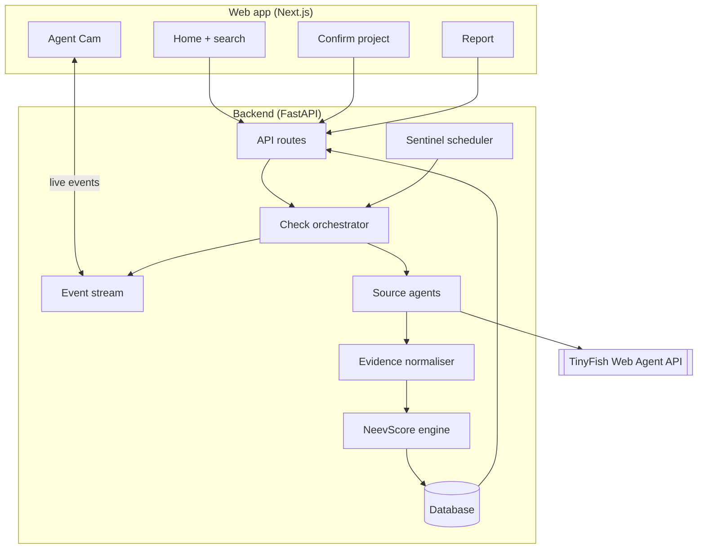
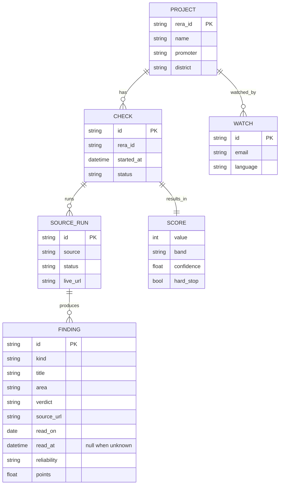

# Architecture

NeevCheck has two parts: a **Next.js** web app that buyers use, and a **FastAPI** service that runs TinyFish browser agents, stores evidence and calculates the NeevScore.

## Request flow

| Step | Endpoint | What happens |
| --- | --- | --- |
| 1. Search | `GET /api/projects/search?q=` | A RERA number opens its UP-RERA page; a name or promoter goes through TinyFish Search (up-rera.in results only) |
| 2. Confirm | `POST /api/checks` | Creates a check for one registration number and starts it; returns the check and its `id` (202) |
| 3. Watch | `GET /api/checks/{id}/events` | Server-Sent Events: `source.started`, `source.live_url`, `source.progress`, `finding.added`, `source.blocked`, `source.completed`, `check.completed` |
| 4. Report | `GET /api/checks/{id}/report` | Score, drivers, evidence and timeline (action plan in Phase 4) |
| 5. Watch list | `POST /api/sentinel` | Adds the project to weekly re-checks *(Phase 5)* |

## Sources

Each source is one small module with the same shape: it reads one kind of public record and yields events (progress, live view URL, findings, which key checks it read). It never writes to the database; the orchestrator does.

| Source | Site | How it reads | Extracts |
| --- | --- | --- | --- |
| `uprera` | up-rera.in | **Fetch** + deterministic Python parser; the summary page is found with Search | name, number, registration date, promoter, type, district, start and end dates, extensions granted, completion certificate date, permits, documents, complaint counts |
| `registry` | MCA, Economic Times, zaubacorp | Search finds the page; **Fetch** + parser reads the details table, an **agent** reads it when Fetch cannot | company name, CIN and status |
| `insolvency` | NCLT / NCLAT orders and reports, IBBI | Search finds a page about the promoter's case; an **agent** reads it | whether the case was admitted, when, and which projects it covers |
| `land` | Noida, Greater Noida and Yamuna Expressway authorities | Search + **Fetch** of the published dues list (usually a PDF), searched in Python | whether the promoter is on a dues list |
| `consumer` | e-Jagriti | an **agent** opens the case search and stops at its CAPTCHA | cases against the promoter, only if the portal shows results without one |
| `news` | news sites, Supreme Court | Search (news) and Fetch of a court order | up to three delay stories, and whether the NBCC order names the project |

UP-RERA runs first: it confirms the project exists and names the promoter the other sources look for. If it cannot be read, the check fails and no score is shown. The other sources run in parallel, at most `AGENT_CONCURRENCY` at a time, each within `AGENT_TIMEOUT_SECONDS`.

### Fetch or agent?

Fetch and Search are cheap, fast and repeatable, so a page that Fetch can turn into text is read in Python. An agent (a real browser driven by a goal in plain English) is only used where a person would have to click: a search form, a page that renders in the browser, an article whose scope has to be read. Each agent source is a module with a `GOAL`, an `OUTPUT_SCHEMA` and a pure `to_findings()` that turns the agent's JSON into findings. Python, not the agent, decides what the facts mean: for example, whether an insolvency covers this project is decided by matching project names word for word, so Eco Village-I is never matched to Eco Village-II.

### Live view and progress

Agent sources share one runner (`app/sources/agent.py`). It maps the agent's stream onto the event stream the Agent Cam reads:

| TinyFish event | NeevCheck event |
| --- | --- |
| started | `source.started` (sent by the orchestrator when the source begins) |
| streaming URL | `source.live_url`, the address of the live browser view |
| progress | `source.progress`, the agent's note cut to one line of at most 140 characters |
| complete | `finding.added` for each finding, then `source.completed` |

The runner tells every agent never to solve or get around a CAPTCHA, and marks the source `blocked` when one appears. It does not trust the agent's own `captcha_seen` flag alone: a progress note that mentions a CAPTCHA also stops the run and blocks the source, because a recorded e-Jagriti run once reported no CAPTCHA while its notes showed it typing one. A run that fails or returns only empty fields leaves the source **unread**, which lowers confidence and never changes the score. A run that runs out of time is `blocked` with the reason `timeout` and is not retried. Agents are opened on deep pages, never on a large homepage, and every run is capped by `AGENT_TIMEOUT_SECONDS`. The raw answer of each agent is saved under `backend/data/cache/{check_id}/{source}.json` (git-ignored) so a surprising finding can be traced back to what the agent returned.

At most `AGENT_CONCURRENCY` (2) agents run at once. TinyFish accepts a step limit only on beta accounts; set `AGENT_SEND_MAX_STEPS=true` once yours is enabled.

## Testing without the network

Tests never call TinyFish. `scripts/capture_fixtures.py` records real responses (UP-RERA pages, search results) into `backend/tests/fixtures/` through the same client and selectors the app uses, and refuses to save a file that contains the API key. `python -m scripts.capture_fixtures check_8334.json` runs one complete live check of `UPRERAPRJ8334` and records every search, document and agent answer, scrubbed of emails, phone numbers and live-view addresses. Tests replay them through a fake `WebClient`, with the clock fixed to the day of the recording, so the score is stable. One optional test, `pytest -m live`, runs a real check when `TINYFISH_API_KEY` is set; it is deselected by default and skipped in CI.

## API

Interactive docs are served at `/docs`.

| Method and path | Success | Errors |
| --- | --- | --- |
| `GET /api/health` | `200 {"status": "ok"}` | |
| `GET /api/projects/search?q=` | `200 {query, candidates[]}`, at most 8 | `422` query shorter than 2 characters, `502` TinyFish unreachable |
| `POST /api/checks` `{rera_id, details_url?}` | `202` check, `Location` header | `422` bad input, `429` over `RATE_LIMIT_PER_MINUTE` (with `Retry-After`) |
| `GET /api/checks/{id}` | `200` check with each source's status | `404`, `422` malformed id |
| `GET /api/checks/{id}/events` | `200 text/event-stream` | `404` |
| `GET /api/checks/{id}/report` | `200` score, drivers, findings, timeline | `404`, `409` still running or failed |

`rera_id` accepts `UPRERAPRJ8334` and new-format numbers such as `UPRERAPRJ188811/08/2024` (case and spaces are ignored). New-format numbers also need the `details_url` that search returned; it must be an `https` link on up-rera.in.

### Events

Every event is sent as `event: <type>` with JSON `data` holding `type`, `check_id`, `source`, `ts` and a `data` object. A browser that connects late receives the whole run from the start. A comment line is sent every 15 seconds while nothing happens.

| Event | `data` |
| --- | --- |
| `source.started` | |
| `source.live_url` | `url` of the live browser view |
| `source.progress` | `text` |
| `finding.added` | `finding` (with `source_url`, `read_on`, `read_at`) |
| `source.blocked` | `reason` (for example a CAPTCHA) |
| `source.completed` | `status` (`completed`, `blocked`, `failed`, `unavailable`), `message`, `checks_read` |
| `check.completed` | `status` (`completed` or `failed`), `score` summary (`value`, `band`, `band_label`, `confidence`, `provisional`, `hard_stop`) or `message`; `source` is `check` |

## Data model

The `WATCH` table is created with Neev Sentinel in Phase 5.
