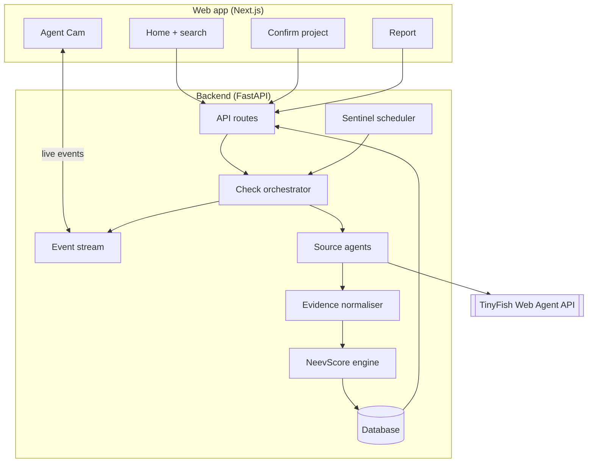
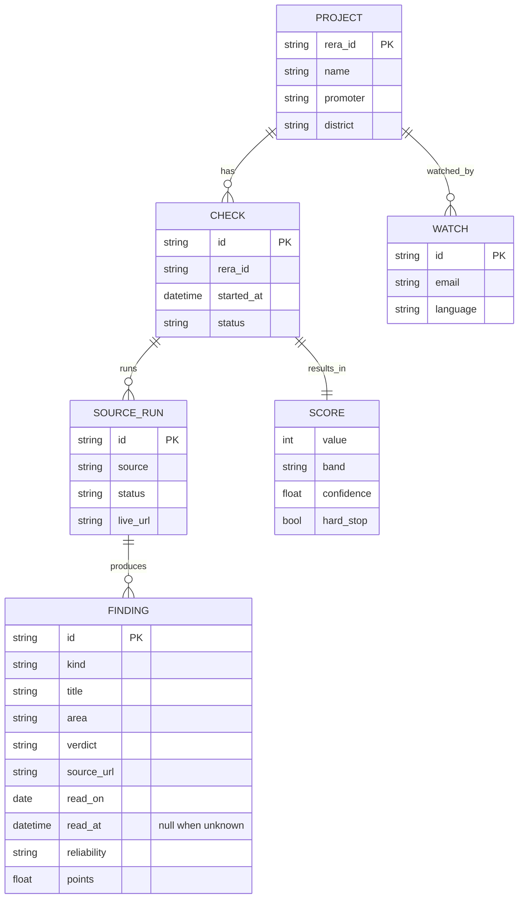

# Architecture

NeevCheck has two parts: a **Next.js** web app that buyers use, and a **FastAPI** service that runs TinyFish browser agents, stores evidence and calculates the NeevScore.

## Request flow

| Step | Endpoint | What happens |
| --- | --- | --- |
| 1. Search (from the browser) | `GET /api/projects/search?q=` | A RERA number is confirmed on its own UP-RERA page; a name or promoter goes through TinyFish Search limited to up-rera.in (see [Finding a project](#finding-a-project)) |
| 2. Confirm | `POST /api/checks` | Creates a check for one registration number and starts it; returns the check and its `id` (202) |
| 3. Watch | `GET /api/checks/{id}/events` | Server-Sent Events: `source.started`, `source.live_url`, `source.progress`, `finding.added`, `source.blocked`, `source.completed`, `check.completed` |
| 4. Report | `GET /api/checks/{id}/report` | Score, drivers, evidence and timeline (action plan in Phase 4) |
| 5. Watch list | `POST /api/sentinel` | Adds the project to weekly re-checks; alerts are read with `GET /api/sentinel/alerts?email=` |

## Finding a project

`app/resolve.py` turns what the buyer typed into at most 8 candidates, each with its name, promoter, district and registration date, and the page a check will read.

| Typed | How it is found |
| --- | --- |
| A number from 2017-18, `UPRERAPRJ8334` | Its stable details page is read directly; no Search |
| A later number, `UPRERAPRJ188811/08/2024` or six digits such as `UPRERAPRJ396176` | These have no stable page, so Search for the exact number on up-rera.in finds its Projectsummary page |
| A project or promoter name | TinyFish Search limited to up-rera.in. If no result carries a number, a second Search without the limit is read for UPRERAPRJ numbers |
| `uprera prj 8334`, `UPRERA-PRJ-8334` | Spaces, hyphens, dots and case are normalised first |

A number counts only when its own up-rera.in page shows it with a name and a promoter. Numbers from the second, unlimited Search must also share a word with the query, because pages about one project often print the numbers of others. Search results are completed from their own pages, four at a time within 35 seconds; a page that cannot be read in time keeps what Search said, since that came from up-rera.in itself. A query with no UP-RERA project (a project outside Uttar Pradesh, for example) returns an empty list, which the app shows as "No UP-RERA project found" with tips.

## Sources

Each source is one small module with the same shape: it reads one kind of public record and yields events (progress, live view URL, findings, which key checks it read). It never writes to the database; the orchestrator does.

| Source | Site | How it reads | Extracts |
| --- | --- | --- | --- |
| `uprera` | up-rera.in | **Fetch** + deterministic Python parser; the summary page is found with Search | name, number, registration date, promoter, type, district, start and end dates, extensions granted, completion certificate date, permits, documents, complaint counts |
| `registry` | MCA, Economic Times, zaubacorp | Search finds the page; **Fetch** + parser reads the details table, an **agent** reads it when Fetch cannot | company name, CIN and status |
| `insolvency` | NCLT / NCLAT orders and reports, IBBI | Search finds a page about the promoter's case; an **agent** reads it | whether the case was admitted, when, and which projects it covers |
| `land` | Noida, Greater Noida and Yamuna Expressway authorities | Search + **Fetch** of the published dues list (usually a PDF), searched in Python | whether the promoter is on a dues list |
| `consumer` | e-Jagriti | an **agent** opens the case search and stops at its CAPTCHA | cases against the promoter, only if the portal shows results without one |
| `news` | news sites, Supreme Court | Search (news) and Fetch of a court order | up to three delay stories, and whether the NBCC order names the project |

UP-RERA runs first: it confirms the project exists and names the promoter the other sources look for. If it cannot be read, the check fails and no score is shown. The other sources run in parallel, at most `AGENT_CONCURRENCY` at a time, each within `AGENT_TIMEOUT_SECONDS`.

### Fetch or agent?

Fetch and Search are cheap, fast and repeatable, so a page that Fetch can turn into text is read in Python. An agent (a real browser driven by a goal in plain English) is only used where a person would have to click: a search form, a page that renders in the browser, an article whose scope has to be read. Each agent source is a module with a `GOAL`, an `OUTPUT_SCHEMA` and a pure `to_findings()` that turns the agent's JSON into findings. Python, not the agent, decides what the facts mean: for example, whether an insolvency covers this project is decided by matching project names word for word, so Eco Village-I is never matched to Eco Village-II.

### Live view and progress

Agent sources share one runner (`app/sources/agent.py`). It maps the agent's stream onto the event stream the Agent Cam reads:

| TinyFish event | NeevCheck event |
| --- | --- |
| started | `source.started` (sent by the orchestrator when the source begins) |
| streaming URL | `source.live_url`, the address of the live browser view |
| progress | `source.progress`, the agent's note cut to one line of at most 140 characters |
| complete | `finding.added` for each finding, then `source.completed` |

The runner tells every agent never to solve or get around a CAPTCHA, and marks the source `blocked` when one appears. It does not trust the agent's own `captcha_seen` flag alone: a progress note that mentions a CAPTCHA also stops the run and blocks the source, because a recorded e-Jagriti run once reported no CAPTCHA while its notes showed it typing one. A run that fails or returns only empty fields leaves the source **unread**, which lowers confidence and never changes the score. A run that runs out of time is `blocked` with the reason `timeout` and is not retried. Agents are opened on deep pages, never on a large homepage, and every run is capped by `AGENT_TIMEOUT_SECONDS`. The raw answer of each agent is saved under `backend/data/cache/{check_id}/{source}.json` (git-ignored) so a surprising finding can be traced back to what the agent returned.

At most `AGENT_CONCURRENCY` (2) agents run at once. TinyFish accepts a step limit only on beta accounts; set `AGENT_SEND_MAX_STEPS=true` once yours is enabled.

## Testing without the network

Tests never call TinyFish. `scripts/capture_fixtures.py` records real responses (UP-RERA pages, search results) into `backend/tests/fixtures/` through the same client and selectors the app uses, and refuses to save a file that contains the API key. `python -m scripts.capture_fixtures check_8334.json` runs one complete live check of `UPRERAPRJ8334` and records every search, document and agent answer, scrubbed of emails, phone numbers and live-view addresses. Tests replay them through a fake `WebClient`, with the clock fixed to the day of the recording, so the score is stable. One optional test, `pytest -m live`, runs a real check when `TINYFISH_API_KEY` is set; it is deselected by default and skipped in CI.

## API

Interactive docs are served at `/docs`.

| Method and path | Success | Errors |
| --- | --- | --- |
| `GET /api/health` | `200 {"status": "ok"}` | |
| `GET /api/projects/search?q=` | `200 {query, candidates[]}`, at most 8; answers within 90 seconds | `422` query shorter than 2 characters; `502` TinyFish failed, `504` too slow, `429` TinyFish rate limit (with `Retry-After`). Each error's `detail.code` names the reason: `tinyfish_key`, `wallet_empty`, `rate_limited`, `timeout`, `unreachable` or `upstream` |
| `POST /api/checks` `{rera_id, details_url?, fresh?}` | `202` check, `Location` header; `200` with `reused: true` when a check of the same project finished in the last 24 hours (send `fresh: true` to re-check) | `422` bad input, `429` over `RATE_LIMIT_PER_MINUTE` or over `MAX_CHECKS_PER_DAY` (`detail.code` is `daily_cap`; both send `Retry-After`) |
| `GET /api/checks?ids=a,b,c` | `200` a summary of each known check (`id`, `rera_id`, `details_url`, `project`, `promoter`, `status`, `score`, `band`, `confidence`, `created_at`, `completed_at`), in the order asked; ids the server does not have are left out | `422` more than 50 ids or a malformed one |
| `GET /api/checks/recent` | `200` the latest finished check of up to 12 projects, newest first, each with its top three drivers, registration date and sources read. No emails or IP addresses | |
| `GET /api/checks/{id}` | `200` check with each source's status | `404`, `422` malformed id |
| `GET /api/checks/{id}/events` | `200 text/event-stream` | `404` |
| `GET /api/checks/{id}/report` | `200` score, drivers, findings, timeline | `404`, `409` still running or failed |
| `POST /api/sentinel` `{rera_id, details_url?, email, language}` | `201` watch (`200` if the same email already watches it) | `422` bad input, `409` more than 3 watches for one email, `429` rate limit |
| `GET /api/sentinel/alerts?email=` | `200` alerts, newest first | `422` bad email |
| `POST /api/sentinel/run` with header `X-Webhook-Secret` | `202` `{started}`; starts a re-check run for an external cron | `401` missing or wrong secret (always, when `WEBHOOK_SECRET` is not set) |

`rera_id` accepts `UPRERAPRJ8334` and new-format numbers such as `UPRERAPRJ188811/08/2024` (case, spaces, hyphens and dots are ignored). Send the `details_url` that search returned; it must be an `https` link on up-rera.in. It is required for new-format numbers, and a number sent without one gets its stable details page, which only numbers registered in 2017-18 have.

### Events

Every event is sent as `event: <type>` with JSON `data` holding `type`, `check_id`, `source`, `ts` and a `data` object. A browser that connects late receives the whole run from the start. A comment line is sent every 15 seconds while nothing happens.

| Event | `data` |
| --- | --- |
| `source.started` | |
| `source.live_url` | `url` of the live browser view |
| `source.progress` | `text` |
| `finding.added` | `finding` (with `source_url`, `read_on`, `read_at`) |
| `source.blocked` | `reason` (for example a CAPTCHA) |
| `source.completed` | `status` (`completed`, `blocked`, `failed`, `unavailable`), `message`, `checks_read` |
| `check.completed` | `status` (`completed` or `failed`), `score` summary (`value`, `band`, `band_label`, `confidence`, `provisional`, `hard_stop`) or `message`; `source` is `check` |

## Data model

## Neev Sentinel

A watch is an email, a project and a language (at most three watches per email). A re-check runs every `SENTINEL_INTERVAL_HOURS` (default 168, one week; `0` turns the built-in schedule off) from a loop in the app's lifespan, and `POST /api/sentinel/run` starts the same run for an external cron; the secret is compared in constant time.

Each re-check is a normal check. It is compared with the check the watch last saw, and **only real changes create an alert**:

- A finding is identified by `source + kind` (plus its link for news stories), never by its title, because titles hold numbers such as "passed 105 months ago" that move every month.
- Two findings with the same key but different facts (a count, an insolvency scope, a date, a verdict) are *changed*. A key only in the new check is *added*; only in the old one, *removed*.
- Only sources that both checks read are compared. Unread to unread is never a change; a source that went unreadable does not make its records "removed", and a source read for the first time does not make them "added".
- The first finished check of a project is a baseline, not a change.

An alert stores the old and new score and the diff, and is shown at `/alerts?email=`. If `SMTP_HOST` and `SMTP_FROM` are set it is also emailed, to the watch's address only; without them it is stored and shown in the app.

### Cost guards

`MAX_CHECKS_PER_DAY` (default 30) caps the checks started per UTC day, Sentinel's included; past it new checks get `429` with the wait until midnight and Sentinel stops its run. A check of the same project that finished in the last 24 hours is returned instead of starting another (`reused: true`); the report then says "Checked X h ago" with a **Re-check now** button that sends `fresh: true`.

## Free-plan cold starts

The API runs on Render's free plan, which sleeps after 15 idle minutes and takes about a minute to wake. Search therefore runs in the **browser**, straight to the API, never in a Vercel function (whose time limit a cold start plus a live search can exceed):

1. The home page sends a silent `GET /api/health` on load, so the server starts while the visitor reads.
2. The confirm page waits for that same ping. If it takes longer than 1.5 seconds it says "Waking up the server…", then "Searching UP-RERA…" once the server answers.
3. Search may take up to 120 seconds in the browser. A dropped connection, or a `502`/`503`/`504` from Render's proxy (no `detail.code`), is retried once. Errors from the API itself carry a `detail.code` and are shown as they are, never retried.

## My reports, without accounts

NeevCheck has no sign-in. The app keeps the ids of the checks a visitor starts in `localStorage` (`neevcheck-reports`, newest first, at most 50) and asks `GET /api/checks?ids=` for their state, so the list is private to that browser. Ids the server no longer knows (for example after its database was reset) are dropped from the list with a note. The home page's report card and its "Recently checked" strip come from `GET /api/checks/recent`, fetched in the browser after the page loads; before any check has finished, the card is an empty frame that says "Your report appears here", never sample numbers.
