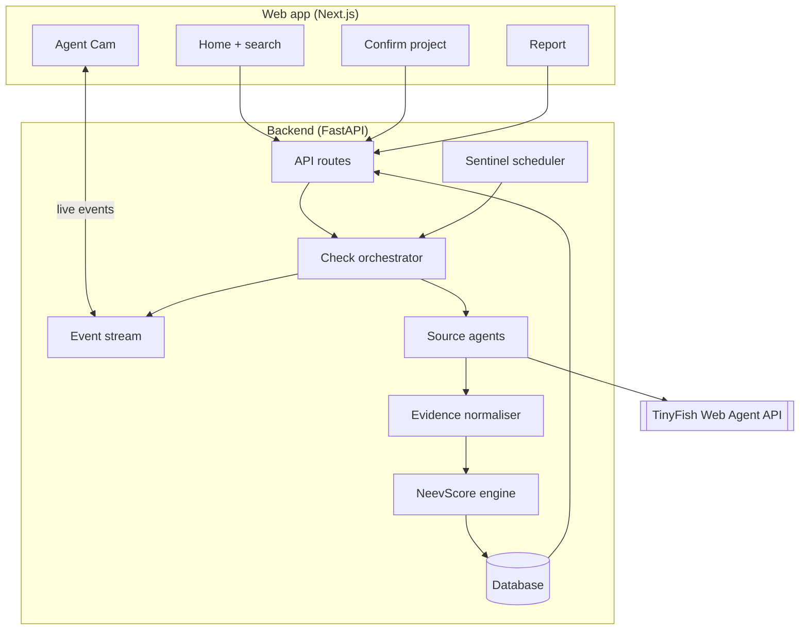
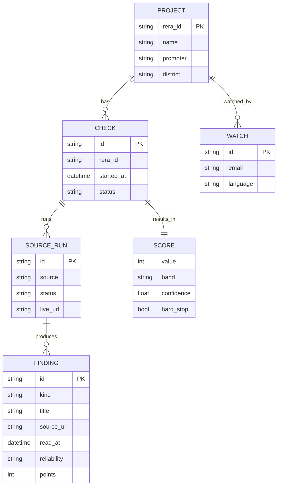

# Architecture

NeevCheck has two parts: a **Next.js** web app that buyers use, and a **FastAPI** service that runs TinyFish browser agents, stores evidence and calculates the NeevScore.

## Request flow

| Step | Endpoint | What happens |
| --- | --- | --- |
| 1. Search | `GET /api/projects/search?q=` | Looks up UP-RERA for matching phases and returns candidates |
| 2. Confirm | `POST /api/checks` | Creates a check for one registration number; returns `check_id` (202) |
| 3. Watch | `GET /api/checks/{id}/events` | Server-Sent Events: `source.started`, `source.live_url`, `source.progress`, `finding.added`, `source.blocked`, `check.completed` |
| 4. Report | `GET /api/checks/{id}/report` | Score, drivers, evidence, timeline and action plan |
| 5. Watch list | `POST /api/sentinel` | Adds the project to weekly re-checks |

## Source agents

Each source is one small module with the same shape: a goal prompt for the TinyFish agent, the fields to extract, and a parser that turns the agent's answer into `Finding` objects.

| Agent | Site | Extracts |
| --- | --- | --- |
| `uprera` | up-rera.in | registration number and date, promoter, completion date, extensions |
| `registry` | mca.gov.in (or a registry mirror) | company status, CIN |
| `insolvency` | ibbi.gov.in, NCLT orders | admitted cases and which projects they cover |
| `land` | Noida, Greater Noida, YEIDA lists | dues or defaulter entries |
| `courts_news` | court reports and news | orders and coverage about the promoter or project |

Agents run in parallel, limited by `AGENT_CONCURRENCY`. A run that meets a CAPTCHA stops and reports `source.blocked`; it is never bypassed.

## Demo mode

With `DEMO_MODE=true` the orchestrator replays a recorded real check (Supertech Eco Village-I Phase I-C, read on 24 Oct 2026) with the same events and timings. This lets anyone run the app and the test suite without an API key.

## Data model

